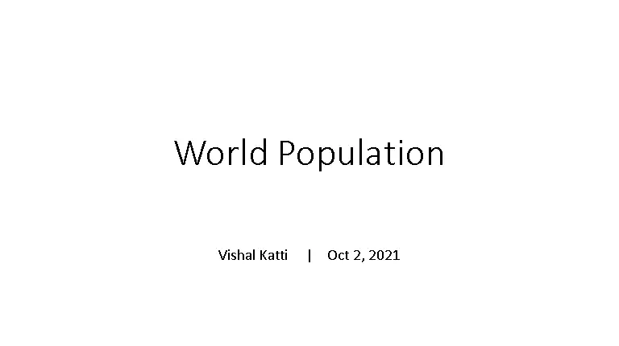
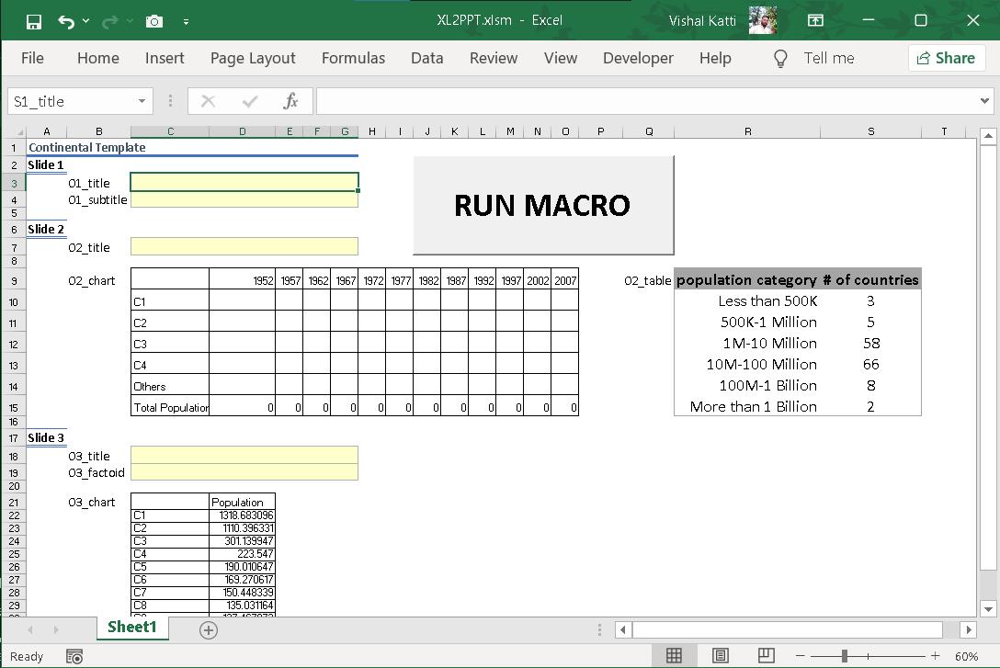
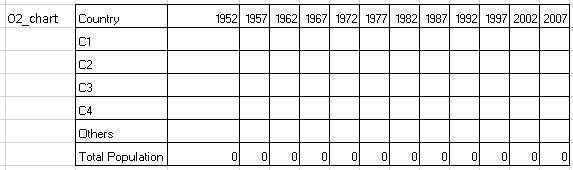
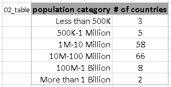
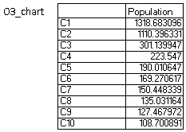
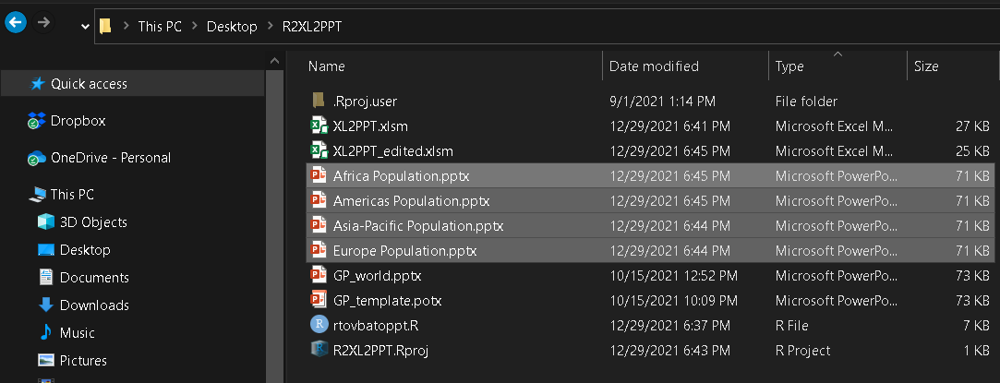

This is part 2 of 2. Read part 1
[here](https://www.vishalkatti.com/posts/R2VBA2PPT1/ "link to Part 1 of this article.").

## Quick Recap

In the previous post, we create the `.potx` template from the `.pptx`
file we wanted to automate and the Excel template with the macro `.xlsm`
that uses the PowerPoint template to create a new `.pptx` file with
given data using VBA.

The report we want to automate is...

{#fig-gapminder}

...and the Excel and PowerPoint template we created are shown in @fig-excel-with-macro.

{#fig-excel-with-macro}

In this post, we will write the R script that will first massage the
data into desired format and then load the data for one region into the
Excel template and execute the VBA macro that will create the PowerPoint
file with that data.

## Strategy

Before we dive into code, we need to check a few things. We wish to
create a presentation for each continent in the Gapminder data. A closer
look at the Presentation will tell you what kind of data we need for
each slide/graph/table while the Excel template will reveal what should
the structure of each dataset should be. While looking into this
structure, some questions will pop-up. The idea here is to create the
datasets in such a way that they can be easily filtered for each
continent and the resultant table can be written to the Excel template
without any or very little modification. Let us proceed slide-by-slide.

## Creating the datasets

### Slide 1

Slide 1 is the title page and needs 2 strings; one for Title, one for
Subtitle. The Title for the base presentation is "World Population". For
each continent, it could be "\<continent_name\> Population". The
subtitle is a combination of Author Name and Created Date. So we need a
string like "\<author_name\> \| \<created_date\>" where created_date is
the formatted system date.

These strings can be created while writing the data to the Excel
template.

### Slide 2

The chart on slide 2 needs raw data structured as below. You will notice
that at a continent-level, this table needs a minimum of 5 countries. Do
we have any continents in the Gapminder data with less than 5 countries?
Yes, we have Oceania with only Australia and New Zealand. For ease of
use, let us include these countries along with Asian countries in a new
`Region` variable.

{#fig-slide2}

We will create the `region` variable in the gapminder data. But first,
let us load some relevant packages.

```r
options(tidyverse.quiet = TRUE)
library(tidyverse) # duh!
library(rmarkdown) # to display the tables interactively in this post. Not really needed for the final solution.
library(openxlsx) # to write the data to the Excel Template.
# library(RDCOMClient) # to load and run the Excel macro post data load.
```

```r
# Read in Gapminder data
gp <- gapminder::gapminder

# Create new region variable
gp <- gp %>%
  mutate(region = if_else(as.character(continent) %in% c("Asia","Oceania"),
                          "Asia-Pacific", 
                          as.character(continent)),
         country = as.character(country))

# Keep only relevant columns
gp <- gp %>% select(region, country, year, pop)

# View details
glimpse(gp)
```

```output
Rows: 1,704
Columns: 4
$ region  <chr> "Asia-Pacific", "Asia-Pacific", "Asia-Pacific", "Asia-Pacific"~
$ country <chr> "Afghanistan", "Afghanistan", "Afghanistan", "Afghanistan", "A~
$ year    <int> 1952, 1957, 1962, 1967, 1972, 1977, 1982, 1987, 1992, 1997, 20~
$ pop     <int> 8425333, 9240934, 10267083, 11537966, 13079460, 14880372, 1288~
```

Now that we have the source data available, we must now create the
datasets we need that we can write to the Excel template for each
region.

The required table in @fig-slide2 shows the top 4 countries (based on 2007 population)
and all other countries clubbed into 'others' in a given region and then
the total population of the region on a yearly basis. This table has to
be created for all 4 regions.

```r
pop_trend <- gp %>%
  group_by(region, country, year) %>% 
  summarise(pop = sum(pop, na.rm = TRUE),
            .groups = 'drop') %>%
  mutate(pop = round(pop/1E6, 0)) %>% # population in millions
  pivot_wider(names_from = year, values_from = pop, names_sort = TRUE) %>% 
  arrange(desc(`2007`)) # sort by max pop to min pop in latest year i.e. 2007

paged_table(pop_trend)
```

<div class="table-wrap data-table"><table>
<thead><tr><th style="text-align:left">region<span class="col-type">chr</span></th><th style="text-align:left">country<span class="col-type">chr</span></th><th style="text-align:right">1952<span class="col-type">dbl</span></th><th style="text-align:right">1957<span class="col-type">dbl</span></th><th style="text-align:right">1962<span class="col-type">dbl</span></th><th style="text-align:right">1967<span class="col-type">dbl</span></th><th style="text-align:right">1972<span class="col-type">dbl</span></th><th style="text-align:right">1977<span class="col-type">dbl</span></th><th style="text-align:right">1982<span class="col-type">dbl</span></th><th style="text-align:right">1987<span class="col-type">dbl</span></th><th style="text-align:right">1992<span class="col-type">dbl</span></th><th style="text-align:right">1997<span class="col-type">dbl</span></th><th style="text-align:right">2002<span class="col-type">dbl</span></th><th style="text-align:right">2007<span class="col-type">dbl</span></th></tr></thead>
<tbody>
<tr><td style="text-align:left">Asia-Pacific</td><td style="text-align:left">China</td><td style="text-align:right">556</td><td style="text-align:right">637</td><td style="text-align:right">666</td><td style="text-align:right">755</td><td style="text-align:right">862</td><td style="text-align:right">943</td><td style="text-align:right">1000</td><td style="text-align:right">1084</td><td style="text-align:right">1165</td><td style="text-align:right">1230</td><td style="text-align:right">1280</td><td style="text-align:right">1319</td></tr>
<tr><td style="text-align:left">Asia-Pacific</td><td style="text-align:left">India</td><td style="text-align:right">372</td><td style="text-align:right">409</td><td style="text-align:right">454</td><td style="text-align:right">506</td><td style="text-align:right">567</td><td style="text-align:right">634</td><td style="text-align:right">708</td><td style="text-align:right">788</td><td style="text-align:right">872</td><td style="text-align:right">959</td><td style="text-align:right">1034</td><td style="text-align:right">1110</td></tr>
<tr><td style="text-align:left">Americas</td><td style="text-align:left">United States</td><td style="text-align:right">158</td><td style="text-align:right">172</td><td style="text-align:right">187</td><td style="text-align:right">199</td><td style="text-align:right">210</td><td style="text-align:right">220</td><td style="text-align:right">232</td><td style="text-align:right">243</td><td style="text-align:right">257</td><td style="text-align:right">273</td><td style="text-align:right">288</td><td style="text-align:right">301</td></tr>
<tr><td style="text-align:left">Asia-Pacific</td><td style="text-align:left">Indonesia</td><td style="text-align:right">82</td><td style="text-align:right">90</td><td style="text-align:right">99</td><td style="text-align:right">109</td><td style="text-align:right">121</td><td style="text-align:right">137</td><td style="text-align:right">153</td><td style="text-align:right">169</td><td style="text-align:right">185</td><td style="text-align:right">199</td><td style="text-align:right">211</td><td style="text-align:right">224</td></tr>
<tr><td style="text-align:left">Americas</td><td style="text-align:left">Brazil</td><td style="text-align:right">57</td><td style="text-align:right">66</td><td style="text-align:right">76</td><td style="text-align:right">88</td><td style="text-align:right">101</td><td style="text-align:right">114</td><td style="text-align:right">129</td><td style="text-align:right">143</td><td style="text-align:right">156</td><td style="text-align:right">169</td><td style="text-align:right">180</td><td style="text-align:right">190</td></tr>
<tr><td style="text-align:left">Asia-Pacific</td><td style="text-align:left">Pakistan</td><td style="text-align:right">41</td><td style="text-align:right">47</td><td style="text-align:right">53</td><td style="text-align:right">61</td><td style="text-align:right">69</td><td style="text-align:right">78</td><td style="text-align:right">91</td><td style="text-align:right">105</td><td style="text-align:right">120</td><td style="text-align:right">136</td><td style="text-align:right">153</td><td style="text-align:right">169</td></tr>
<tr><td style="text-align:left">Asia-Pacific</td><td style="text-align:left">Bangladesh</td><td style="text-align:right">47</td><td style="text-align:right">51</td><td style="text-align:right">57</td><td style="text-align:right">63</td><td style="text-align:right">71</td><td style="text-align:right">80</td><td style="text-align:right">93</td><td style="text-align:right">104</td><td style="text-align:right">114</td><td style="text-align:right">123</td><td style="text-align:right">136</td><td style="text-align:right">150</td></tr>
<tr><td style="text-align:left">Africa</td><td style="text-align:left">Nigeria</td><td style="text-align:right">33</td><td style="text-align:right">37</td><td style="text-align:right">42</td><td style="text-align:right">47</td><td style="text-align:right">54</td><td style="text-align:right">62</td><td style="text-align:right">73</td><td style="text-align:right">82</td><td style="text-align:right">93</td><td style="text-align:right">106</td><td style="text-align:right">120</td><td style="text-align:right">135</td></tr>
<tr><td style="text-align:left">Asia-Pacific</td><td style="text-align:left">Japan</td><td style="text-align:right">86</td><td style="text-align:right">92</td><td style="text-align:right">96</td><td style="text-align:right">101</td><td style="text-align:right">107</td><td style="text-align:right">114</td><td style="text-align:right">118</td><td style="text-align:right">122</td><td style="text-align:right">124</td><td style="text-align:right">126</td><td style="text-align:right">127</td><td style="text-align:right">127</td></tr>
<tr><td style="text-align:left">Americas</td><td style="text-align:left">Mexico</td><td style="text-align:right">30</td><td style="text-align:right">35</td><td style="text-align:right">41</td><td style="text-align:right">48</td><td style="text-align:right">56</td><td style="text-align:right">64</td><td style="text-align:right">72</td><td style="text-align:right">80</td><td style="text-align:right">88</td><td style="text-align:right">96</td><td style="text-align:right">102</td><td style="text-align:right">109</td></tr>
<tr><td style="text-align:left">Asia-Pacific</td><td style="text-align:left">Philippines</td><td style="text-align:right">22</td><td style="text-align:right">26</td><td style="text-align:right">30</td><td style="text-align:right">35</td><td style="text-align:right">41</td><td style="text-align:right">47</td><td style="text-align:right">53</td><td style="text-align:right">60</td><td style="text-align:right">67</td><td style="text-align:right">75</td><td style="text-align:right">83</td><td style="text-align:right">91</td></tr>
<tr><td style="text-align:left">Asia-Pacific</td><td style="text-align:left">Vietnam</td><td style="text-align:right">26</td><td style="text-align:right">29</td><td style="text-align:right">34</td><td style="text-align:right">39</td><td style="text-align:right">45</td><td style="text-align:right">51</td><td style="text-align:right">56</td><td style="text-align:right">63</td><td style="text-align:right">70</td><td style="text-align:right">76</td><td style="text-align:right">81</td><td style="text-align:right">85</td></tr>
<tr><td style="text-align:left">Europe</td><td style="text-align:left">Germany</td><td style="text-align:right">69</td><td style="text-align:right">71</td><td style="text-align:right">74</td><td style="text-align:right">76</td><td style="text-align:right">79</td><td style="text-align:right">78</td><td style="text-align:right">78</td><td style="text-align:right">78</td><td style="text-align:right">81</td><td style="text-align:right">82</td><td style="text-align:right">82</td><td style="text-align:right">82</td></tr>
<tr><td style="text-align:left">Africa</td><td style="text-align:left">Egypt</td><td style="text-align:right">22</td><td style="text-align:right">25</td><td style="text-align:right">28</td><td style="text-align:right">32</td><td style="text-align:right">35</td><td style="text-align:right">39</td><td style="text-align:right">46</td><td style="text-align:right">53</td><td style="text-align:right">59</td><td style="text-align:right">66</td><td style="text-align:right">73</td><td style="text-align:right">80</td></tr>
<tr><td style="text-align:left">Africa</td><td style="text-align:left">Ethiopia</td><td style="text-align:right">21</td><td style="text-align:right">23</td><td style="text-align:right">25</td><td style="text-align:right">28</td><td style="text-align:right">31</td><td style="text-align:right">35</td><td style="text-align:right">38</td><td style="text-align:right">43</td><td style="text-align:right">52</td><td style="text-align:right">60</td><td style="text-align:right">68</td><td style="text-align:right">77</td></tr>
<tr><td style="text-align:left">Europe</td><td style="text-align:left">Turkey</td><td style="text-align:right">22</td><td style="text-align:right">26</td><td style="text-align:right">30</td><td style="text-align:right">33</td><td style="text-align:right">37</td><td style="text-align:right">42</td><td style="text-align:right">47</td><td style="text-align:right">53</td><td style="text-align:right">58</td><td style="text-align:right">63</td><td style="text-align:right">67</td><td style="text-align:right">71</td></tr>
<tr><td style="text-align:left">Asia-Pacific</td><td style="text-align:left">Iran</td><td style="text-align:right">17</td><td style="text-align:right">20</td><td style="text-align:right">23</td><td style="text-align:right">27</td><td style="text-align:right">31</td><td style="text-align:right">35</td><td style="text-align:right">43</td><td style="text-align:right">52</td><td style="text-align:right">60</td><td style="text-align:right">63</td><td style="text-align:right">67</td><td style="text-align:right">69</td></tr>
<tr><td style="text-align:left">Africa</td><td style="text-align:left">Congo, Dem. Rep.</td><td style="text-align:right">14</td><td style="text-align:right">16</td><td style="text-align:right">17</td><td style="text-align:right">20</td><td style="text-align:right">23</td><td style="text-align:right">26</td><td style="text-align:right">31</td><td style="text-align:right">35</td><td style="text-align:right">42</td><td style="text-align:right">48</td><td style="text-align:right">55</td><td style="text-align:right">65</td></tr>
<tr><td style="text-align:left">Asia-Pacific</td><td style="text-align:left">Thailand</td><td style="text-align:right">21</td><td style="text-align:right">25</td><td style="text-align:right">29</td><td style="text-align:right">34</td><td style="text-align:right">39</td><td style="text-align:right">44</td><td style="text-align:right">49</td><td style="text-align:right">53</td><td style="text-align:right">57</td><td style="text-align:right">60</td><td style="text-align:right">63</td><td style="text-align:right">65</td></tr>
<tr><td style="text-align:left">Europe</td><td style="text-align:left">France</td><td style="text-align:right">42</td><td style="text-align:right">44</td><td style="text-align:right">47</td><td style="text-align:right">50</td><td style="text-align:right">52</td><td style="text-align:right">53</td><td style="text-align:right">54</td><td style="text-align:right">56</td><td style="text-align:right">57</td><td style="text-align:right">59</td><td style="text-align:right">60</td><td style="text-align:right">61</td></tr>
<tr><td style="text-align:left">Europe</td><td style="text-align:left">United Kingdom</td><td style="text-align:right">50</td><td style="text-align:right">51</td><td style="text-align:right">53</td><td style="text-align:right">55</td><td style="text-align:right">56</td><td style="text-align:right">56</td><td style="text-align:right">56</td><td style="text-align:right">57</td><td style="text-align:right">58</td><td style="text-align:right">59</td><td style="text-align:right">60</td><td style="text-align:right">61</td></tr>
<tr><td style="text-align:left">Europe</td><td style="text-align:left">Italy</td><td style="text-align:right">48</td><td style="text-align:right">49</td><td style="text-align:right">51</td><td style="text-align:right">53</td><td style="text-align:right">54</td><td style="text-align:right">56</td><td style="text-align:right">57</td><td style="text-align:right">57</td><td style="text-align:right">57</td><td style="text-align:right">57</td><td style="text-align:right">58</td><td style="text-align:right">58</td></tr>
<tr><td style="text-align:left">Asia-Pacific</td><td style="text-align:left">Korea, Rep.</td><td style="text-align:right">21</td><td style="text-align:right">23</td><td style="text-align:right">26</td><td style="text-align:right">30</td><td style="text-align:right">34</td><td style="text-align:right">36</td><td style="text-align:right">39</td><td style="text-align:right">42</td><td style="text-align:right">44</td><td style="text-align:right">46</td><td style="text-align:right">48</td><td style="text-align:right">49</td></tr>
<tr><td style="text-align:left">Asia-Pacific</td><td style="text-align:left">Myanmar</td><td style="text-align:right">20</td><td style="text-align:right">22</td><td style="text-align:right">24</td><td style="text-align:right">26</td><td style="text-align:right">28</td><td style="text-align:right">32</td><td style="text-align:right">35</td><td style="text-align:right">38</td><td style="text-align:right">41</td><td style="text-align:right">43</td><td style="text-align:right">46</td><td style="text-align:right">48</td></tr>
<tr><td style="text-align:left">Africa</td><td style="text-align:left">South Africa</td><td style="text-align:right">14</td><td style="text-align:right">16</td><td style="text-align:right">18</td><td style="text-align:right">21</td><td style="text-align:right">24</td><td style="text-align:right">27</td><td style="text-align:right">31</td><td style="text-align:right">36</td><td style="text-align:right">40</td><td style="text-align:right">43</td><td style="text-align:right">44</td><td style="text-align:right">44</td></tr>
<tr><td style="text-align:left">Americas</td><td style="text-align:left">Colombia</td><td style="text-align:right">12</td><td style="text-align:right">14</td><td style="text-align:right">17</td><td style="text-align:right">20</td><td style="text-align:right">23</td><td style="text-align:right">25</td><td style="text-align:right">28</td><td style="text-align:right">31</td><td style="text-align:right">34</td><td style="text-align:right">38</td><td style="text-align:right">41</td><td style="text-align:right">44</td></tr>
<tr><td style="text-align:left">Africa</td><td style="text-align:left">Sudan</td><td style="text-align:right">9</td><td style="text-align:right">10</td><td style="text-align:right">11</td><td style="text-align:right">13</td><td style="text-align:right">15</td><td style="text-align:right">17</td><td style="text-align:right">20</td><td style="text-align:right">25</td><td style="text-align:right">28</td><td style="text-align:right">32</td><td style="text-align:right">37</td><td style="text-align:right">42</td></tr>
<tr><td style="text-align:left">Americas</td><td style="text-align:left">Argentina</td><td style="text-align:right">18</td><td style="text-align:right">20</td><td style="text-align:right">21</td><td style="text-align:right">23</td><td style="text-align:right">25</td><td style="text-align:right">27</td><td style="text-align:right">29</td><td style="text-align:right">32</td><td style="text-align:right">34</td><td style="text-align:right">36</td><td style="text-align:right">38</td><td style="text-align:right">40</td></tr>
<tr><td style="text-align:left">Europe</td><td style="text-align:left">Spain</td><td style="text-align:right">29</td><td style="text-align:right">30</td><td style="text-align:right">31</td><td style="text-align:right">33</td><td style="text-align:right">35</td><td style="text-align:right">36</td><td style="text-align:right">38</td><td style="text-align:right">39</td><td style="text-align:right">40</td><td style="text-align:right">40</td><td style="text-align:right">40</td><td style="text-align:right">40</td></tr>
<tr><td style="text-align:left">Europe</td><td style="text-align:left">Poland</td><td style="text-align:right">26</td><td style="text-align:right">28</td><td style="text-align:right">30</td><td style="text-align:right">32</td><td style="text-align:right">33</td><td style="text-align:right">35</td><td style="text-align:right">36</td><td style="text-align:right">38</td><td style="text-align:right">38</td><td style="text-align:right">39</td><td style="text-align:right">39</td><td style="text-align:right">39</td></tr>
<tr><td style="text-align:left">Africa</td><td style="text-align:left">Tanzania</td><td style="text-align:right">8</td><td style="text-align:right">9</td><td style="text-align:right">11</td><td style="text-align:right">13</td><td style="text-align:right">15</td><td style="text-align:right">17</td><td style="text-align:right">20</td><td style="text-align:right">23</td><td style="text-align:right">27</td><td style="text-align:right">31</td><td style="text-align:right">35</td><td style="text-align:right">38</td></tr>
<tr><td style="text-align:left">Africa</td><td style="text-align:left">Kenya</td><td style="text-align:right">6</td><td style="text-align:right">7</td><td style="text-align:right">9</td><td style="text-align:right">10</td><td style="text-align:right">12</td><td style="text-align:right">15</td><td style="text-align:right">18</td><td style="text-align:right">21</td><td style="text-align:right">25</td><td style="text-align:right">28</td><td style="text-align:right">31</td><td style="text-align:right">36</td></tr>
<tr><td style="text-align:left">Africa</td><td style="text-align:left">Morocco</td><td style="text-align:right">10</td><td style="text-align:right">11</td><td style="text-align:right">13</td><td style="text-align:right">15</td><td style="text-align:right">17</td><td style="text-align:right">18</td><td style="text-align:right">20</td><td style="text-align:right">23</td><td style="text-align:right">26</td><td style="text-align:right">29</td><td style="text-align:right">31</td><td style="text-align:right">34</td></tr>
<tr><td style="text-align:left">Africa</td><td style="text-align:left">Algeria</td><td style="text-align:right">9</td><td style="text-align:right">10</td><td style="text-align:right">11</td><td style="text-align:right">13</td><td style="text-align:right">15</td><td style="text-align:right">17</td><td style="text-align:right">20</td><td style="text-align:right">23</td><td style="text-align:right">26</td><td style="text-align:right">29</td><td style="text-align:right">31</td><td style="text-align:right">33</td></tr>
<tr><td style="text-align:left">Americas</td><td style="text-align:left">Canada</td><td style="text-align:right">15</td><td style="text-align:right">17</td><td style="text-align:right">19</td><td style="text-align:right">21</td><td style="text-align:right">22</td><td style="text-align:right">24</td><td style="text-align:right">25</td><td style="text-align:right">27</td><td style="text-align:right">29</td><td style="text-align:right">30</td><td style="text-align:right">32</td><td style="text-align:right">33</td></tr>
<tr><td style="text-align:left">Asia-Pacific</td><td style="text-align:left">Afghanistan</td><td style="text-align:right">8</td><td style="text-align:right">9</td><td style="text-align:right">10</td><td style="text-align:right">12</td><td style="text-align:right">13</td><td style="text-align:right">15</td><td style="text-align:right">13</td><td style="text-align:right">14</td><td style="text-align:right">16</td><td style="text-align:right">22</td><td style="text-align:right">25</td><td style="text-align:right">32</td></tr>
<tr><td style="text-align:left">Africa</td><td style="text-align:left">Uganda</td><td style="text-align:right">6</td><td style="text-align:right">7</td><td style="text-align:right">8</td><td style="text-align:right">9</td><td style="text-align:right">10</td><td style="text-align:right">11</td><td style="text-align:right">13</td><td style="text-align:right">15</td><td style="text-align:right">18</td><td style="text-align:right">21</td><td style="text-align:right">25</td><td style="text-align:right">29</td></tr>
<tr><td style="text-align:left">Americas</td><td style="text-align:left">Peru</td><td style="text-align:right">8</td><td style="text-align:right">9</td><td style="text-align:right">11</td><td style="text-align:right">12</td><td style="text-align:right">14</td><td style="text-align:right">16</td><td style="text-align:right">18</td><td style="text-align:right">20</td><td style="text-align:right">22</td><td style="text-align:right">25</td><td style="text-align:right">27</td><td style="text-align:right">29</td></tr>
<tr><td style="text-align:left">Asia-Pacific</td><td style="text-align:left">Nepal</td><td style="text-align:right">9</td><td style="text-align:right">10</td><td style="text-align:right">10</td><td style="text-align:right">11</td><td style="text-align:right">12</td><td style="text-align:right">14</td><td style="text-align:right">16</td><td style="text-align:right">18</td><td style="text-align:right">20</td><td style="text-align:right">23</td><td style="text-align:right">26</td><td style="text-align:right">29</td></tr>
<tr><td style="text-align:left">Asia-Pacific</td><td style="text-align:left">Saudi Arabia</td><td style="text-align:right">4</td><td style="text-align:right">4</td><td style="text-align:right">5</td><td style="text-align:right">6</td><td style="text-align:right">6</td><td style="text-align:right">8</td><td style="text-align:right">11</td><td style="text-align:right">15</td><td style="text-align:right">17</td><td style="text-align:right">21</td><td style="text-align:right">25</td><td style="text-align:right">28</td></tr>
<tr><td style="text-align:left">Asia-Pacific</td><td style="text-align:left">Iraq</td><td style="text-align:right">5</td><td style="text-align:right">6</td><td style="text-align:right">7</td><td style="text-align:right">9</td><td style="text-align:right">10</td><td style="text-align:right">12</td><td style="text-align:right">14</td><td style="text-align:right">17</td><td style="text-align:right">18</td><td style="text-align:right">21</td><td style="text-align:right">24</td><td style="text-align:right">27</td></tr>
<tr><td style="text-align:left">Americas</td><td style="text-align:left">Venezuela</td><td style="text-align:right">5</td><td style="text-align:right">7</td><td style="text-align:right">8</td><td style="text-align:right">10</td><td style="text-align:right">12</td><td style="text-align:right">14</td><td style="text-align:right">16</td><td style="text-align:right">18</td><td style="text-align:right">20</td><td style="text-align:right">22</td><td style="text-align:right">24</td><td style="text-align:right">26</td></tr>
<tr><td style="text-align:left">Asia-Pacific</td><td style="text-align:left">Malaysia</td><td style="text-align:right">7</td><td style="text-align:right">8</td><td style="text-align:right">9</td><td style="text-align:right">10</td><td style="text-align:right">11</td><td style="text-align:right">13</td><td style="text-align:right">14</td><td style="text-align:right">16</td><td style="text-align:right">18</td><td style="text-align:right">20</td><td style="text-align:right">23</td><td style="text-align:right">25</td></tr>
<tr><td style="text-align:left">Africa</td><td style="text-align:left">Ghana</td><td style="text-align:right">6</td><td style="text-align:right">6</td><td style="text-align:right">7</td><td style="text-align:right">8</td><td style="text-align:right">9</td><td style="text-align:right">11</td><td style="text-align:right">11</td><td style="text-align:right">14</td><td style="text-align:right">16</td><td style="text-align:right">18</td><td style="text-align:right">21</td><td style="text-align:right">23</td></tr>
<tr><td style="text-align:left">Asia-Pacific</td><td style="text-align:left">Korea, Dem. Rep.</td><td style="text-align:right">9</td><td style="text-align:right">9</td><td style="text-align:right">11</td><td style="text-align:right">13</td><td style="text-align:right">15</td><td style="text-align:right">16</td><td style="text-align:right">18</td><td style="text-align:right">19</td><td style="text-align:right">21</td><td style="text-align:right">22</td><td style="text-align:right">22</td><td style="text-align:right">23</td></tr>
<tr><td style="text-align:left">Asia-Pacific</td><td style="text-align:left">Taiwan</td><td style="text-align:right">9</td><td style="text-align:right">10</td><td style="text-align:right">12</td><td style="text-align:right">14</td><td style="text-align:right">15</td><td style="text-align:right">17</td><td style="text-align:right">19</td><td style="text-align:right">20</td><td style="text-align:right">21</td><td style="text-align:right">22</td><td style="text-align:right">22</td><td style="text-align:right">23</td></tr>
<tr><td style="text-align:left">Asia-Pacific</td><td style="text-align:left">Yemen, Rep.</td><td style="text-align:right">5</td><td style="text-align:right">5</td><td style="text-align:right">6</td><td style="text-align:right">7</td><td style="text-align:right">7</td><td style="text-align:right">8</td><td style="text-align:right">10</td><td style="text-align:right">11</td><td style="text-align:right">13</td><td style="text-align:right">16</td><td style="text-align:right">19</td><td style="text-align:right">22</td></tr>
<tr><td style="text-align:left">Europe</td><td style="text-align:left">Romania</td><td style="text-align:right">17</td><td style="text-align:right">18</td><td style="text-align:right">19</td><td style="text-align:right">19</td><td style="text-align:right">21</td><td style="text-align:right">22</td><td style="text-align:right">22</td><td style="text-align:right">23</td><td style="text-align:right">23</td><td style="text-align:right">23</td><td style="text-align:right">22</td><td style="text-align:right">22</td></tr>
<tr><td style="text-align:left">Africa</td><td style="text-align:left">Mozambique</td><td style="text-align:right">6</td><td style="text-align:right">7</td><td style="text-align:right">8</td><td style="text-align:right">9</td><td style="text-align:right">10</td><td style="text-align:right">11</td><td style="text-align:right">13</td><td style="text-align:right">13</td><td style="text-align:right">13</td><td style="text-align:right">17</td><td style="text-align:right">18</td><td style="text-align:right">20</td></tr>
<tr><td style="text-align:left">Asia-Pacific</td><td style="text-align:left">Australia</td><td style="text-align:right">9</td><td style="text-align:right">10</td><td style="text-align:right">11</td><td style="text-align:right">12</td><td style="text-align:right">13</td><td style="text-align:right">14</td><td style="text-align:right">15</td><td style="text-align:right">16</td><td style="text-align:right">17</td><td style="text-align:right">19</td><td style="text-align:right">20</td><td style="text-align:right">20</td></tr>
<tr><td style="text-align:left">Asia-Pacific</td><td style="text-align:left">Sri Lanka</td><td style="text-align:right">8</td><td style="text-align:right">9</td><td style="text-align:right">10</td><td style="text-align:right">12</td><td style="text-align:right">13</td><td style="text-align:right">14</td><td style="text-align:right">15</td><td style="text-align:right">16</td><td style="text-align:right">18</td><td style="text-align:right">19</td><td style="text-align:right">20</td><td style="text-align:right">20</td></tr>
<tr><td style="text-align:left">Africa</td><td style="text-align:left">Madagascar</td><td style="text-align:right">5</td><td style="text-align:right">5</td><td style="text-align:right">6</td><td style="text-align:right">6</td><td style="text-align:right">7</td><td style="text-align:right">8</td><td style="text-align:right">9</td><td style="text-align:right">11</td><td style="text-align:right">12</td><td style="text-align:right">14</td><td style="text-align:right">16</td><td style="text-align:right">19</td></tr>
<tr><td style="text-align:left">Asia-Pacific</td><td style="text-align:left">Syria</td><td style="text-align:right">4</td><td style="text-align:right">4</td><td style="text-align:right">5</td><td style="text-align:right">6</td><td style="text-align:right">7</td><td style="text-align:right">8</td><td style="text-align:right">9</td><td style="text-align:right">11</td><td style="text-align:right">13</td><td style="text-align:right">15</td><td style="text-align:right">17</td><td style="text-align:right">19</td></tr>
<tr><td style="text-align:left">Africa</td><td style="text-align:left">Cameroon</td><td style="text-align:right">5</td><td style="text-align:right">5</td><td style="text-align:right">6</td><td style="text-align:right">6</td><td style="text-align:right">7</td><td style="text-align:right">8</td><td style="text-align:right">9</td><td style="text-align:right">11</td><td style="text-align:right">12</td><td style="text-align:right">14</td><td style="text-align:right">16</td><td style="text-align:right">18</td></tr>
<tr><td style="text-align:left">Africa</td><td style="text-align:left">Cote d'Ivoire</td><td style="text-align:right">3</td><td style="text-align:right">3</td><td style="text-align:right">4</td><td style="text-align:right">5</td><td style="text-align:right">6</td><td style="text-align:right">7</td><td style="text-align:right">9</td><td style="text-align:right">11</td><td style="text-align:right">13</td><td style="text-align:right">15</td><td style="text-align:right">16</td><td style="text-align:right">18</td></tr>
<tr><td style="text-align:left">Europe</td><td style="text-align:left">Netherlands</td><td style="text-align:right">10</td><td style="text-align:right">11</td><td style="text-align:right">12</td><td style="text-align:right">13</td><td style="text-align:right">13</td><td style="text-align:right">14</td><td style="text-align:right">14</td><td style="text-align:right">15</td><td style="text-align:right">15</td><td style="text-align:right">16</td><td style="text-align:right">16</td><td style="text-align:right">17</td></tr>
<tr><td style="text-align:left">Americas</td><td style="text-align:left">Chile</td><td style="text-align:right">6</td><td style="text-align:right">7</td><td style="text-align:right">8</td><td style="text-align:right">9</td><td style="text-align:right">10</td><td style="text-align:right">11</td><td style="text-align:right">11</td><td style="text-align:right">12</td><td style="text-align:right">14</td><td style="text-align:right">15</td><td style="text-align:right">15</td><td style="text-align:right">16</td></tr>
<tr><td style="text-align:left">Africa</td><td style="text-align:left">Burkina Faso</td><td style="text-align:right">4</td><td style="text-align:right">5</td><td style="text-align:right">5</td><td style="text-align:right">5</td><td style="text-align:right">5</td><td style="text-align:right">6</td><td style="text-align:right">7</td><td style="text-align:right">8</td><td style="text-align:right">9</td><td style="text-align:right">10</td><td style="text-align:right">12</td><td style="text-align:right">14</td></tr>
<tr><td style="text-align:left">Americas</td><td style="text-align:left">Ecuador</td><td style="text-align:right">4</td><td style="text-align:right">4</td><td style="text-align:right">5</td><td style="text-align:right">5</td><td style="text-align:right">6</td><td style="text-align:right">7</td><td style="text-align:right">8</td><td style="text-align:right">10</td><td style="text-align:right">11</td><td style="text-align:right">12</td><td style="text-align:right">13</td><td style="text-align:right">14</td></tr>
<tr><td style="text-align:left">Asia-Pacific</td><td style="text-align:left">Cambodia</td><td style="text-align:right">5</td><td style="text-align:right">5</td><td style="text-align:right">6</td><td style="text-align:right">7</td><td style="text-align:right">7</td><td style="text-align:right">7</td><td style="text-align:right">7</td><td style="text-align:right">8</td><td style="text-align:right">10</td><td style="text-align:right">12</td><td style="text-align:right">13</td><td style="text-align:right">14</td></tr>
<tr><td style="text-align:left">Africa</td><td style="text-align:left">Malawi</td><td style="text-align:right">3</td><td style="text-align:right">3</td><td style="text-align:right">4</td><td style="text-align:right">4</td><td style="text-align:right">5</td><td style="text-align:right">6</td><td style="text-align:right">7</td><td style="text-align:right">8</td><td style="text-align:right">10</td><td style="text-align:right">10</td><td style="text-align:right">12</td><td style="text-align:right">13</td></tr>
<tr><td style="text-align:left">Africa</td><td style="text-align:left">Niger</td><td style="text-align:right">3</td><td style="text-align:right">4</td><td style="text-align:right">4</td><td style="text-align:right">5</td><td style="text-align:right">5</td><td style="text-align:right">6</td><td style="text-align:right">6</td><td style="text-align:right">7</td><td style="text-align:right">8</td><td style="text-align:right">10</td><td style="text-align:right">11</td><td style="text-align:right">13</td></tr>
<tr><td style="text-align:left">Americas</td><td style="text-align:left">Guatemala</td><td style="text-align:right">3</td><td style="text-align:right">4</td><td style="text-align:right">4</td><td style="text-align:right">5</td><td style="text-align:right">5</td><td style="text-align:right">6</td><td style="text-align:right">6</td><td style="text-align:right">7</td><td style="text-align:right">8</td><td style="text-align:right">10</td><td style="text-align:right">11</td><td style="text-align:right">13</td></tr>
<tr><td style="text-align:left">Africa</td><td style="text-align:left">Angola</td><td style="text-align:right">4</td><td style="text-align:right">5</td><td style="text-align:right">5</td><td style="text-align:right">5</td><td style="text-align:right">6</td><td style="text-align:right">6</td><td style="text-align:right">7</td><td style="text-align:right">8</td><td style="text-align:right">9</td><td style="text-align:right">10</td><td style="text-align:right">11</td><td style="text-align:right">12</td></tr>
<tr><td style="text-align:left">Africa</td><td style="text-align:left">Mali</td><td style="text-align:right">4</td><td style="text-align:right">4</td><td style="text-align:right">5</td><td style="text-align:right">5</td><td style="text-align:right">6</td><td style="text-align:right">6</td><td style="text-align:right">7</td><td style="text-align:right">8</td><td style="text-align:right">8</td><td style="text-align:right">9</td><td style="text-align:right">11</td><td style="text-align:right">12</td></tr>
<tr><td style="text-align:left">Africa</td><td style="text-align:left">Senegal</td><td style="text-align:right">3</td><td style="text-align:right">3</td><td style="text-align:right">3</td><td style="text-align:right">4</td><td style="text-align:right">5</td><td style="text-align:right">5</td><td style="text-align:right">6</td><td style="text-align:right">7</td><td style="text-align:right">8</td><td style="text-align:right">10</td><td style="text-align:right">11</td><td style="text-align:right">12</td></tr>
<tr><td style="text-align:left">Africa</td><td style="text-align:left">Zambia</td><td style="text-align:right">3</td><td style="text-align:right">3</td><td style="text-align:right">3</td><td style="text-align:right">4</td><td style="text-align:right">5</td><td style="text-align:right">5</td><td style="text-align:right">6</td><td style="text-align:right">7</td><td style="text-align:right">8</td><td style="text-align:right">9</td><td style="text-align:right">11</td><td style="text-align:right">12</td></tr>
<tr><td style="text-align:left">Africa</td><td style="text-align:left">Zimbabwe</td><td style="text-align:right">3</td><td style="text-align:right">4</td><td style="text-align:right">4</td><td style="text-align:right">5</td><td style="text-align:right">6</td><td style="text-align:right">7</td><td style="text-align:right">8</td><td style="text-align:right">9</td><td style="text-align:right">11</td><td style="text-align:right">11</td><td style="text-align:right">12</td><td style="text-align:right">12</td></tr>
<tr><td style="text-align:left">Americas</td><td style="text-align:left">Cuba</td><td style="text-align:right">6</td><td style="text-align:right">7</td><td style="text-align:right">7</td><td style="text-align:right">8</td><td style="text-align:right">9</td><td style="text-align:right">10</td><td style="text-align:right">10</td><td style="text-align:right">10</td><td style="text-align:right">11</td><td style="text-align:right">11</td><td style="text-align:right">11</td><td style="text-align:right">11</td></tr>
<tr><td style="text-align:left">Europe</td><td style="text-align:left">Greece</td><td style="text-align:right">8</td><td style="text-align:right">8</td><td style="text-align:right">8</td><td style="text-align:right">9</td><td style="text-align:right">9</td><td style="text-align:right">9</td><td style="text-align:right">10</td><td style="text-align:right">10</td><td style="text-align:right">10</td><td style="text-align:right">11</td><td style="text-align:right">11</td><td style="text-align:right">11</td></tr>
<tr><td style="text-align:left">Europe</td><td style="text-align:left">Portugal</td><td style="text-align:right">9</td><td style="text-align:right">9</td><td style="text-align:right">9</td><td style="text-align:right">9</td><td style="text-align:right">9</td><td style="text-align:right">10</td><td style="text-align:right">10</td><td style="text-align:right">10</td><td style="text-align:right">10</td><td style="text-align:right">10</td><td style="text-align:right">10</td><td style="text-align:right">11</td></tr>
<tr><td style="text-align:left">Africa</td><td style="text-align:left">Chad</td><td style="text-align:right">3</td><td style="text-align:right">3</td><td style="text-align:right">3</td><td style="text-align:right">3</td><td style="text-align:right">4</td><td style="text-align:right">4</td><td style="text-align:right">5</td><td style="text-align:right">5</td><td style="text-align:right">6</td><td style="text-align:right">8</td><td style="text-align:right">9</td><td style="text-align:right">10</td></tr>
<tr><td style="text-align:left">Africa</td><td style="text-align:left">Guinea</td><td style="text-align:right">3</td><td style="text-align:right">3</td><td style="text-align:right">3</td><td style="text-align:right">3</td><td style="text-align:right">4</td><td style="text-align:right">4</td><td style="text-align:right">5</td><td style="text-align:right">6</td><td style="text-align:right">7</td><td style="text-align:right">8</td><td style="text-align:right">9</td><td style="text-align:right">10</td></tr>
<tr><td style="text-align:left">Africa</td><td style="text-align:left">Tunisia</td><td style="text-align:right">4</td><td style="text-align:right">4</td><td style="text-align:right">4</td><td style="text-align:right">5</td><td style="text-align:right">5</td><td style="text-align:right">6</td><td style="text-align:right">7</td><td style="text-align:right">8</td><td style="text-align:right">9</td><td style="text-align:right">9</td><td style="text-align:right">10</td><td style="text-align:right">10</td></tr>
<tr><td style="text-align:left">Europe</td><td style="text-align:left">Belgium</td><td style="text-align:right">9</td><td style="text-align:right">9</td><td style="text-align:right">9</td><td style="text-align:right">10</td><td style="text-align:right">10</td><td style="text-align:right">10</td><td style="text-align:right">10</td><td style="text-align:right">10</td><td style="text-align:right">10</td><td style="text-align:right">10</td><td style="text-align:right">10</td><td style="text-align:right">10</td></tr>
<tr><td style="text-align:left">Europe</td><td style="text-align:left">Czech Republic</td><td style="text-align:right">9</td><td style="text-align:right">10</td><td style="text-align:right">10</td><td style="text-align:right">10</td><td style="text-align:right">10</td><td style="text-align:right">10</td><td style="text-align:right">10</td><td style="text-align:right">10</td><td style="text-align:right">10</td><td style="text-align:right">10</td><td style="text-align:right">10</td><td style="text-align:right">10</td></tr>
<tr><td style="text-align:left">Europe</td><td style="text-align:left">Hungary</td><td style="text-align:right">10</td><td style="text-align:right">10</td><td style="text-align:right">10</td><td style="text-align:right">10</td><td style="text-align:right">10</td><td style="text-align:right">11</td><td style="text-align:right">11</td><td style="text-align:right">11</td><td style="text-align:right">10</td><td style="text-align:right">10</td><td style="text-align:right">10</td><td style="text-align:right">10</td></tr>
<tr><td style="text-align:left">Europe</td><td style="text-align:left">Serbia</td><td style="text-align:right">7</td><td style="text-align:right">7</td><td style="text-align:right">8</td><td style="text-align:right">8</td><td style="text-align:right">8</td><td style="text-align:right">9</td><td style="text-align:right">9</td><td style="text-align:right">9</td><td style="text-align:right">10</td><td style="text-align:right">10</td><td style="text-align:right">10</td><td style="text-align:right">10</td></tr>
<tr><td style="text-align:left">Africa</td><td style="text-align:left">Rwanda</td><td style="text-align:right">3</td><td style="text-align:right">3</td><td style="text-align:right">3</td><td style="text-align:right">3</td><td style="text-align:right">4</td><td style="text-align:right">5</td><td style="text-align:right">6</td><td style="text-align:right">6</td><td style="text-align:right">7</td><td style="text-align:right">7</td><td style="text-align:right">8</td><td style="text-align:right">9</td></tr>
<tr><td style="text-align:left">Africa</td><td style="text-align:left">Somalia</td><td style="text-align:right">3</td><td style="text-align:right">3</td><td style="text-align:right">3</td><td style="text-align:right">3</td><td style="text-align:right">4</td><td style="text-align:right">4</td><td style="text-align:right">6</td><td style="text-align:right">7</td><td style="text-align:right">6</td><td style="text-align:right">7</td><td style="text-align:right">8</td><td style="text-align:right">9</td></tr>
<tr><td style="text-align:left">Americas</td><td style="text-align:left">Bolivia</td><td style="text-align:right">3</td><td style="text-align:right">3</td><td style="text-align:right">4</td><td style="text-align:right">4</td><td style="text-align:right">5</td><td style="text-align:right">5</td><td style="text-align:right">6</td><td style="text-align:right">6</td><td style="text-align:right">7</td><td style="text-align:right">8</td><td style="text-align:right">8</td><td style="text-align:right">9</td></tr>
<tr><td style="text-align:left">Americas</td><td style="text-align:left">Dominican Republic</td><td style="text-align:right">2</td><td style="text-align:right">3</td><td style="text-align:right">3</td><td style="text-align:right">4</td><td style="text-align:right">5</td><td style="text-align:right">5</td><td style="text-align:right">6</td><td style="text-align:right">7</td><td style="text-align:right">7</td><td style="text-align:right">8</td><td style="text-align:right">9</td><td style="text-align:right">9</td></tr>
<tr><td style="text-align:left">Americas</td><td style="text-align:left">Haiti</td><td style="text-align:right">3</td><td style="text-align:right">4</td><td style="text-align:right">4</td><td style="text-align:right">4</td><td style="text-align:right">5</td><td style="text-align:right">5</td><td style="text-align:right">5</td><td style="text-align:right">6</td><td style="text-align:right">6</td><td style="text-align:right">7</td><td style="text-align:right">8</td><td style="text-align:right">9</td></tr>
<tr><td style="text-align:left">Europe</td><td style="text-align:left">Sweden</td><td style="text-align:right">7</td><td style="text-align:right">7</td><td style="text-align:right">8</td><td style="text-align:right">8</td><td style="text-align:right">8</td><td style="text-align:right">8</td><td style="text-align:right">8</td><td style="text-align:right">8</td><td style="text-align:right">9</td><td style="text-align:right">9</td><td style="text-align:right">9</td><td style="text-align:right">9</td></tr>
<tr><td style="text-align:left">Africa</td><td style="text-align:left">Benin</td><td style="text-align:right">2</td><td style="text-align:right">2</td><td style="text-align:right">2</td><td style="text-align:right">2</td><td style="text-align:right">3</td><td style="text-align:right">3</td><td style="text-align:right">4</td><td style="text-align:right">4</td><td style="text-align:right">5</td><td style="text-align:right">6</td><td style="text-align:right">7</td><td style="text-align:right">8</td></tr>
<tr><td style="text-align:left">Africa</td><td style="text-align:left">Burundi</td><td style="text-align:right">2</td><td style="text-align:right">3</td><td style="text-align:right">3</td><td style="text-align:right">3</td><td style="text-align:right">4</td><td style="text-align:right">4</td><td style="text-align:right">5</td><td style="text-align:right">5</td><td style="text-align:right">6</td><td style="text-align:right">6</td><td style="text-align:right">7</td><td style="text-align:right">8</td></tr>
<tr><td style="text-align:left">Europe</td><td style="text-align:left">Austria</td><td style="text-align:right">7</td><td style="text-align:right">7</td><td style="text-align:right">7</td><td style="text-align:right">7</td><td style="text-align:right">8</td><td style="text-align:right">8</td><td style="text-align:right">8</td><td style="text-align:right">8</td><td style="text-align:right">8</td><td style="text-align:right">8</td><td style="text-align:right">8</td><td style="text-align:right">8</td></tr>
<tr><td style="text-align:left">Europe</td><td style="text-align:left">Switzerland</td><td style="text-align:right">5</td><td style="text-align:right">5</td><td style="text-align:right">6</td><td style="text-align:right">6</td><td style="text-align:right">6</td><td style="text-align:right">6</td><td style="text-align:right">6</td><td style="text-align:right">7</td><td style="text-align:right">7</td><td style="text-align:right">7</td><td style="text-align:right">7</td><td style="text-align:right">8</td></tr>
<tr><td style="text-align:left">Americas</td><td style="text-align:left">El Salvador</td><td style="text-align:right">2</td><td style="text-align:right">2</td><td style="text-align:right">3</td><td style="text-align:right">3</td><td style="text-align:right">4</td><td style="text-align:right">4</td><td style="text-align:right">4</td><td style="text-align:right">5</td><td style="text-align:right">5</td><td style="text-align:right">6</td><td style="text-align:right">6</td><td style="text-align:right">7</td></tr>
<tr><td style="text-align:left">Americas</td><td style="text-align:left">Honduras</td><td style="text-align:right">2</td><td style="text-align:right">2</td><td style="text-align:right">2</td><td style="text-align:right">3</td><td style="text-align:right">3</td><td style="text-align:right">3</td><td style="text-align:right">4</td><td style="text-align:right">4</td><td style="text-align:right">5</td><td style="text-align:right">6</td><td style="text-align:right">7</td><td style="text-align:right">7</td></tr>
<tr><td style="text-align:left">Americas</td><td style="text-align:left">Paraguay</td><td style="text-align:right">2</td><td style="text-align:right">2</td><td style="text-align:right">2</td><td style="text-align:right">2</td><td style="text-align:right">3</td><td style="text-align:right">3</td><td style="text-align:right">3</td><td style="text-align:right">4</td><td style="text-align:right">4</td><td style="text-align:right">5</td><td style="text-align:right">6</td><td style="text-align:right">7</td></tr>
<tr><td style="text-align:left">Asia-Pacific</td><td style="text-align:left">Hong Kong, China</td><td style="text-align:right">2</td><td style="text-align:right">3</td><td style="text-align:right">3</td><td style="text-align:right">4</td><td style="text-align:right">4</td><td style="text-align:right">5</td><td style="text-align:right">5</td><td style="text-align:right">6</td><td style="text-align:right">6</td><td style="text-align:right">6</td><td style="text-align:right">7</td><td style="text-align:right">7</td></tr>
<tr><td style="text-align:left">Europe</td><td style="text-align:left">Bulgaria</td><td style="text-align:right">7</td><td style="text-align:right">8</td><td style="text-align:right">8</td><td style="text-align:right">8</td><td style="text-align:right">9</td><td style="text-align:right">9</td><td style="text-align:right">9</td><td style="text-align:right">9</td><td style="text-align:right">9</td><td style="text-align:right">8</td><td style="text-align:right">8</td><td style="text-align:right">7</td></tr>
<tr><td style="text-align:left">Africa</td><td style="text-align:left">Libya</td><td style="text-align:right">1</td><td style="text-align:right">1</td><td style="text-align:right">1</td><td style="text-align:right">2</td><td style="text-align:right">2</td><td style="text-align:right">3</td><td style="text-align:right">3</td><td style="text-align:right">4</td><td style="text-align:right">4</td><td style="text-align:right">5</td><td style="text-align:right">5</td><td style="text-align:right">6</td></tr>
<tr><td style="text-align:left">Africa</td><td style="text-align:left">Sierra Leone</td><td style="text-align:right">2</td><td style="text-align:right">2</td><td style="text-align:right">2</td><td style="text-align:right">3</td><td style="text-align:right">3</td><td style="text-align:right">3</td><td style="text-align:right">3</td><td style="text-align:right">4</td><td style="text-align:right">4</td><td style="text-align:right">5</td><td style="text-align:right">5</td><td style="text-align:right">6</td></tr>
<tr><td style="text-align:left">Africa</td><td style="text-align:left">Togo</td><td style="text-align:right">1</td><td style="text-align:right">1</td><td style="text-align:right">2</td><td style="text-align:right">2</td><td style="text-align:right">2</td><td style="text-align:right">2</td><td style="text-align:right">3</td><td style="text-align:right">3</td><td style="text-align:right">4</td><td style="text-align:right">4</td><td style="text-align:right">5</td><td style="text-align:right">6</td></tr>
<tr><td style="text-align:left">Americas</td><td style="text-align:left">Nicaragua</td><td style="text-align:right">1</td><td style="text-align:right">1</td><td style="text-align:right">2</td><td style="text-align:right">2</td><td style="text-align:right">2</td><td style="text-align:right">3</td><td style="text-align:right">3</td><td style="text-align:right">3</td><td style="text-align:right">4</td><td style="text-align:right">5</td><td style="text-align:right">5</td><td style="text-align:right">6</td></tr>
<tr><td style="text-align:left">Asia-Pacific</td><td style="text-align:left">Israel</td><td style="text-align:right">2</td><td style="text-align:right">2</td><td style="text-align:right">2</td><td style="text-align:right">3</td><td style="text-align:right">3</td><td style="text-align:right">3</td><td style="text-align:right">4</td><td style="text-align:right">4</td><td style="text-align:right">5</td><td style="text-align:right">6</td><td style="text-align:right">6</td><td style="text-align:right">6</td></tr>
<tr><td style="text-align:left">Asia-Pacific</td><td style="text-align:left">Jordan</td><td style="text-align:right">1</td><td style="text-align:right">1</td><td style="text-align:right">1</td><td style="text-align:right">1</td><td style="text-align:right">2</td><td style="text-align:right">2</td><td style="text-align:right">2</td><td style="text-align:right">3</td><td style="text-align:right">4</td><td style="text-align:right">5</td><td style="text-align:right">5</td><td style="text-align:right">6</td></tr>
<tr><td style="text-align:left">Africa</td><td style="text-align:left">Eritrea</td><td style="text-align:right">1</td><td style="text-align:right">2</td><td style="text-align:right">2</td><td style="text-align:right">2</td><td style="text-align:right">2</td><td style="text-align:right">3</td><td style="text-align:right">3</td><td style="text-align:right">3</td><td style="text-align:right">4</td><td style="text-align:right">4</td><td style="text-align:right">4</td><td style="text-align:right">5</td></tr>
<tr><td style="text-align:left">Asia-Pacific</td><td style="text-align:left">Singapore</td><td style="text-align:right">1</td><td style="text-align:right">1</td><td style="text-align:right">2</td><td style="text-align:right">2</td><td style="text-align:right">2</td><td style="text-align:right">2</td><td style="text-align:right">3</td><td style="text-align:right">3</td><td style="text-align:right">3</td><td style="text-align:right">4</td><td style="text-align:right">4</td><td style="text-align:right">5</td></tr>
<tr><td style="text-align:left">Europe</td><td style="text-align:left">Bosnia and Herzegovina</td><td style="text-align:right">3</td><td style="text-align:right">3</td><td style="text-align:right">3</td><td style="text-align:right">4</td><td style="text-align:right">4</td><td style="text-align:right">4</td><td style="text-align:right">4</td><td style="text-align:right">4</td><td style="text-align:right">4</td><td style="text-align:right">4</td><td style="text-align:right">4</td><td style="text-align:right">5</td></tr>
<tr><td style="text-align:left">Europe</td><td style="text-align:left">Denmark</td><td style="text-align:right">4</td><td style="text-align:right">4</td><td style="text-align:right">5</td><td style="text-align:right">5</td><td style="text-align:right">5</td><td style="text-align:right">5</td><td style="text-align:right">5</td><td style="text-align:right">5</td><td style="text-align:right">5</td><td style="text-align:right">5</td><td style="text-align:right">5</td><td style="text-align:right">5</td></tr>
<tr><td style="text-align:left">Europe</td><td style="text-align:left">Finland</td><td style="text-align:right">4</td><td style="text-align:right">4</td><td style="text-align:right">4</td><td style="text-align:right">5</td><td style="text-align:right">5</td><td style="text-align:right">5</td><td style="text-align:right">5</td><td style="text-align:right">5</td><td style="text-align:right">5</td><td style="text-align:right">5</td><td style="text-align:right">5</td><td style="text-align:right">5</td></tr>
<tr><td style="text-align:left">Europe</td><td style="text-align:left">Norway</td><td style="text-align:right">3</td><td style="text-align:right">3</td><td style="text-align:right">4</td><td style="text-align:right">4</td><td style="text-align:right">4</td><td style="text-align:right">4</td><td style="text-align:right">4</td><td style="text-align:right">4</td><td style="text-align:right">4</td><td style="text-align:right">4</td><td style="text-align:right">5</td><td style="text-align:right">5</td></tr>
<tr><td style="text-align:left">Europe</td><td style="text-align:left">Slovak Republic</td><td style="text-align:right">4</td><td style="text-align:right">4</td><td style="text-align:right">4</td><td style="text-align:right">4</td><td style="text-align:right">5</td><td style="text-align:right">5</td><td style="text-align:right">5</td><td style="text-align:right">5</td><td style="text-align:right">5</td><td style="text-align:right">5</td><td style="text-align:right">5</td><td style="text-align:right">5</td></tr>
<tr><td style="text-align:left">Africa</td><td style="text-align:left">Central African Republic</td><td style="text-align:right">1</td><td style="text-align:right">1</td><td style="text-align:right">2</td><td style="text-align:right">2</td><td style="text-align:right">2</td><td style="text-align:right">2</td><td style="text-align:right">2</td><td style="text-align:right">3</td><td style="text-align:right">3</td><td style="text-align:right">4</td><td style="text-align:right">4</td><td style="text-align:right">4</td></tr>
<tr><td style="text-align:left">Africa</td><td style="text-align:left">Congo, Rep.</td><td style="text-align:right">1</td><td style="text-align:right">1</td><td style="text-align:right">1</td><td style="text-align:right">1</td><td style="text-align:right">1</td><td style="text-align:right">2</td><td style="text-align:right">2</td><td style="text-align:right">2</td><td style="text-align:right">2</td><td style="text-align:right">3</td><td style="text-align:right">3</td><td style="text-align:right">4</td></tr>
<tr><td style="text-align:left">Americas</td><td style="text-align:left">Costa Rica</td><td style="text-align:right">1</td><td style="text-align:right">1</td><td style="text-align:right">1</td><td style="text-align:right">2</td><td style="text-align:right">2</td><td style="text-align:right">2</td><td style="text-align:right">2</td><td style="text-align:right">3</td><td style="text-align:right">3</td><td style="text-align:right">4</td><td style="text-align:right">4</td><td style="text-align:right">4</td></tr>
<tr><td style="text-align:left">Americas</td><td style="text-align:left">Puerto Rico</td><td style="text-align:right">2</td><td style="text-align:right">2</td><td style="text-align:right">2</td><td style="text-align:right">3</td><td style="text-align:right">3</td><td style="text-align:right">3</td><td style="text-align:right">3</td><td style="text-align:right">3</td><td style="text-align:right">4</td><td style="text-align:right">4</td><td style="text-align:right">4</td><td style="text-align:right">4</td></tr>
<tr><td style="text-align:left">Asia-Pacific</td><td style="text-align:left">Lebanon</td><td style="text-align:right">1</td><td style="text-align:right">2</td><td style="text-align:right">2</td><td style="text-align:right">2</td><td style="text-align:right">3</td><td style="text-align:right">3</td><td style="text-align:right">3</td><td style="text-align:right">3</td><td style="text-align:right">3</td><td style="text-align:right">3</td><td style="text-align:right">4</td><td style="text-align:right">4</td></tr>
<tr><td style="text-align:left">Asia-Pacific</td><td style="text-align:left">New Zealand</td><td style="text-align:right">2</td><td style="text-align:right">2</td><td style="text-align:right">2</td><td style="text-align:right">3</td><td style="text-align:right">3</td><td style="text-align:right">3</td><td style="text-align:right">3</td><td style="text-align:right">3</td><td style="text-align:right">3</td><td style="text-align:right">4</td><td style="text-align:right">4</td><td style="text-align:right">4</td></tr>
<tr><td style="text-align:left">Asia-Pacific</td><td style="text-align:left">West Bank and Gaza</td><td style="text-align:right">1</td><td style="text-align:right">1</td><td style="text-align:right">1</td><td style="text-align:right">1</td><td style="text-align:right">1</td><td style="text-align:right">1</td><td style="text-align:right">1</td><td style="text-align:right">2</td><td style="text-align:right">2</td><td style="text-align:right">3</td><td style="text-align:right">3</td><td style="text-align:right">4</td></tr>
<tr><td style="text-align:left">Europe</td><td style="text-align:left">Albania</td><td style="text-align:right">1</td><td style="text-align:right">1</td><td style="text-align:right">2</td><td style="text-align:right">2</td><td style="text-align:right">2</td><td style="text-align:right">3</td><td style="text-align:right">3</td><td style="text-align:right">3</td><td style="text-align:right">3</td><td style="text-align:right">3</td><td style="text-align:right">4</td><td style="text-align:right">4</td></tr>
<tr><td style="text-align:left">Europe</td><td style="text-align:left">Croatia</td><td style="text-align:right">4</td><td style="text-align:right">4</td><td style="text-align:right">4</td><td style="text-align:right">4</td><td style="text-align:right">4</td><td style="text-align:right">4</td><td style="text-align:right">4</td><td style="text-align:right">4</td><td style="text-align:right">4</td><td style="text-align:right">4</td><td style="text-align:right">4</td><td style="text-align:right">4</td></tr>
<tr><td style="text-align:left">Europe</td><td style="text-align:left">Ireland</td><td style="text-align:right">3</td><td style="text-align:right">3</td><td style="text-align:right">3</td><td style="text-align:right">3</td><td style="text-align:right">3</td><td style="text-align:right">3</td><td style="text-align:right">3</td><td style="text-align:right">4</td><td style="text-align:right">4</td><td style="text-align:right">4</td><td style="text-align:right">4</td><td style="text-align:right">4</td></tr>
<tr><td style="text-align:left">Africa</td><td style="text-align:left">Liberia</td><td style="text-align:right">1</td><td style="text-align:right">1</td><td style="text-align:right">1</td><td style="text-align:right">1</td><td style="text-align:right">1</td><td style="text-align:right">2</td><td style="text-align:right">2</td><td style="text-align:right">2</td><td style="text-align:right">2</td><td style="text-align:right">2</td><td style="text-align:right">3</td><td style="text-align:right">3</td></tr>
<tr><td style="text-align:left">Africa</td><td style="text-align:left">Mauritania</td><td style="text-align:right">1</td><td style="text-align:right">1</td><td style="text-align:right">1</td><td style="text-align:right">1</td><td style="text-align:right">1</td><td style="text-align:right">1</td><td style="text-align:right">2</td><td style="text-align:right">2</td><td style="text-align:right">2</td><td style="text-align:right">2</td><td style="text-align:right">3</td><td style="text-align:right">3</td></tr>
<tr><td style="text-align:left">Americas</td><td style="text-align:left">Jamaica</td><td style="text-align:right">1</td><td style="text-align:right">2</td><td style="text-align:right">2</td><td style="text-align:right">2</td><td style="text-align:right">2</td><td style="text-align:right">2</td><td style="text-align:right">2</td><td style="text-align:right">2</td><td style="text-align:right">2</td><td style="text-align:right">3</td><td style="text-align:right">3</td><td style="text-align:right">3</td></tr>
<tr><td style="text-align:left">Americas</td><td style="text-align:left">Panama</td><td style="text-align:right">1</td><td style="text-align:right">1</td><td style="text-align:right">1</td><td style="text-align:right">1</td><td style="text-align:right">2</td><td style="text-align:right">2</td><td style="text-align:right">2</td><td style="text-align:right">2</td><td style="text-align:right">2</td><td style="text-align:right">3</td><td style="text-align:right">3</td><td style="text-align:right">3</td></tr>
<tr><td style="text-align:left">Americas</td><td style="text-align:left">Uruguay</td><td style="text-align:right">2</td><td style="text-align:right">2</td><td style="text-align:right">3</td><td style="text-align:right">3</td><td style="text-align:right">3</td><td style="text-align:right">3</td><td style="text-align:right">3</td><td style="text-align:right">3</td><td style="text-align:right">3</td><td style="text-align:right">3</td><td style="text-align:right">3</td><td style="text-align:right">3</td></tr>
<tr><td style="text-align:left">Asia-Pacific</td><td style="text-align:left">Kuwait</td><td style="text-align:right">0</td><td style="text-align:right">0</td><td style="text-align:right">0</td><td style="text-align:right">1</td><td style="text-align:right">1</td><td style="text-align:right">1</td><td style="text-align:right">1</td><td style="text-align:right">2</td><td style="text-align:right">1</td><td style="text-align:right">2</td><td style="text-align:right">2</td><td style="text-align:right">3</td></tr>
<tr><td style="text-align:left">Asia-Pacific</td><td style="text-align:left">Mongolia</td><td style="text-align:right">1</td><td style="text-align:right">1</td><td style="text-align:right">1</td><td style="text-align:right">1</td><td style="text-align:right">1</td><td style="text-align:right">2</td><td style="text-align:right">2</td><td style="text-align:right">2</td><td style="text-align:right">2</td><td style="text-align:right">2</td><td style="text-align:right">3</td><td style="text-align:right">3</td></tr>
<tr><td style="text-align:left">Asia-Pacific</td><td style="text-align:left">Oman</td><td style="text-align:right">1</td><td style="text-align:right">1</td><td style="text-align:right">1</td><td style="text-align:right">1</td><td style="text-align:right">1</td><td style="text-align:right">1</td><td style="text-align:right">1</td><td style="text-align:right">2</td><td style="text-align:right">2</td><td style="text-align:right">2</td><td style="text-align:right">3</td><td style="text-align:right">3</td></tr>
<tr><td style="text-align:left">Africa</td><td style="text-align:left">Botswana</td><td style="text-align:right">0</td><td style="text-align:right">0</td><td style="text-align:right">1</td><td style="text-align:right">1</td><td style="text-align:right">1</td><td style="text-align:right">1</td><td style="text-align:right">1</td><td style="text-align:right">1</td><td style="text-align:right">1</td><td style="text-align:right">2</td><td style="text-align:right">2</td><td style="text-align:right">2</td></tr>
<tr><td style="text-align:left">Africa</td><td style="text-align:left">Gambia</td><td style="text-align:right">0</td><td style="text-align:right">0</td><td style="text-align:right">0</td><td style="text-align:right">0</td><td style="text-align:right">1</td><td style="text-align:right">1</td><td style="text-align:right">1</td><td style="text-align:right">1</td><td style="text-align:right">1</td><td style="text-align:right">1</td><td style="text-align:right">1</td><td style="text-align:right">2</td></tr>
<tr><td style="text-align:left">Africa</td><td style="text-align:left">Lesotho</td><td style="text-align:right">1</td><td style="text-align:right">1</td><td style="text-align:right">1</td><td style="text-align:right">1</td><td style="text-align:right">1</td><td style="text-align:right">1</td><td style="text-align:right">1</td><td style="text-align:right">2</td><td style="text-align:right">2</td><td style="text-align:right">2</td><td style="text-align:right">2</td><td style="text-align:right">2</td></tr>
<tr><td style="text-align:left">Africa</td><td style="text-align:left">Namibia</td><td style="text-align:right">0</td><td style="text-align:right">1</td><td style="text-align:right">1</td><td style="text-align:right">1</td><td style="text-align:right">1</td><td style="text-align:right">1</td><td style="text-align:right">1</td><td style="text-align:right">1</td><td style="text-align:right">2</td><td style="text-align:right">2</td><td style="text-align:right">2</td><td style="text-align:right">2</td></tr>
<tr><td style="text-align:left">Europe</td><td style="text-align:left">Slovenia</td><td style="text-align:right">1</td><td style="text-align:right">2</td><td style="text-align:right">2</td><td style="text-align:right">2</td><td style="text-align:right">2</td><td style="text-align:right">2</td><td style="text-align:right">2</td><td style="text-align:right">2</td><td style="text-align:right">2</td><td style="text-align:right">2</td><td style="text-align:right">2</td><td style="text-align:right">2</td></tr>
<tr><td style="text-align:left">Africa</td><td style="text-align:left">Comoros</td><td style="text-align:right">0</td><td style="text-align:right">0</td><td style="text-align:right">0</td><td style="text-align:right">0</td><td style="text-align:right">0</td><td style="text-align:right">0</td><td style="text-align:right">0</td><td style="text-align:right">0</td><td style="text-align:right">0</td><td style="text-align:right">1</td><td style="text-align:right">1</td><td style="text-align:right">1</td></tr>
<tr><td style="text-align:left">Africa</td><td style="text-align:left">Equatorial Guinea</td><td style="text-align:right">0</td><td style="text-align:right">0</td><td style="text-align:right">0</td><td style="text-align:right">0</td><td style="text-align:right">0</td><td style="text-align:right">0</td><td style="text-align:right">0</td><td style="text-align:right">0</td><td style="text-align:right">0</td><td style="text-align:right">0</td><td style="text-align:right">0</td><td style="text-align:right">1</td></tr>
<tr><td style="text-align:left">Africa</td><td style="text-align:left">Gabon</td><td style="text-align:right">0</td><td style="text-align:right">0</td><td style="text-align:right">0</td><td style="text-align:right">0</td><td style="text-align:right">1</td><td style="text-align:right">1</td><td style="text-align:right">1</td><td style="text-align:right">1</td><td style="text-align:right">1</td><td style="text-align:right">1</td><td style="text-align:right">1</td><td style="text-align:right">1</td></tr>
<tr><td style="text-align:left">Africa</td><td style="text-align:left">Guinea-Bissau</td><td style="text-align:right">1</td><td style="text-align:right">1</td><td style="text-align:right">1</td><td style="text-align:right">1</td><td style="text-align:right">1</td><td style="text-align:right">1</td><td style="text-align:right">1</td><td style="text-align:right">1</td><td style="text-align:right">1</td><td style="text-align:right">1</td><td style="text-align:right">1</td><td style="text-align:right">1</td></tr>
<tr><td style="text-align:left">Africa</td><td style="text-align:left">Mauritius</td><td style="text-align:right">1</td><td style="text-align:right">1</td><td style="text-align:right">1</td><td style="text-align:right">1</td><td style="text-align:right">1</td><td style="text-align:right">1</td><td style="text-align:right">1</td><td style="text-align:right">1</td><td style="text-align:right">1</td><td style="text-align:right">1</td><td style="text-align:right">1</td><td style="text-align:right">1</td></tr>
<tr><td style="text-align:left">Africa</td><td style="text-align:left">Reunion</td><td style="text-align:right">0</td><td style="text-align:right">0</td><td style="text-align:right">0</td><td style="text-align:right">0</td><td style="text-align:right">0</td><td style="text-align:right">0</td><td style="text-align:right">1</td><td style="text-align:right">1</td><td style="text-align:right">1</td><td style="text-align:right">1</td><td style="text-align:right">1</td><td style="text-align:right">1</td></tr>
<tr><td style="text-align:left">Africa</td><td style="text-align:left">Swaziland</td><td style="text-align:right">0</td><td style="text-align:right">0</td><td style="text-align:right">0</td><td style="text-align:right">0</td><td style="text-align:right">0</td><td style="text-align:right">1</td><td style="text-align:right">1</td><td style="text-align:right">1</td><td style="text-align:right">1</td><td style="text-align:right">1</td><td style="text-align:right">1</td><td style="text-align:right">1</td></tr>
<tr><td style="text-align:left">Americas</td><td style="text-align:left">Trinidad and Tobago</td><td style="text-align:right">1</td><td style="text-align:right">1</td><td style="text-align:right">1</td><td style="text-align:right">1</td><td style="text-align:right">1</td><td style="text-align:right">1</td><td style="text-align:right">1</td><td style="text-align:right">1</td><td style="text-align:right">1</td><td style="text-align:right">1</td><td style="text-align:right">1</td><td style="text-align:right">1</td></tr>
<tr><td style="text-align:left">Asia-Pacific</td><td style="text-align:left">Bahrain</td><td style="text-align:right">0</td><td style="text-align:right">0</td><td style="text-align:right">0</td><td style="text-align:right">0</td><td style="text-align:right">0</td><td style="text-align:right">0</td><td style="text-align:right">0</td><td style="text-align:right">0</td><td style="text-align:right">1</td><td style="text-align:right">1</td><td style="text-align:right">1</td><td style="text-align:right">1</td></tr>
<tr><td style="text-align:left">Europe</td><td style="text-align:left">Montenegro</td><td style="text-align:right">0</td><td style="text-align:right">0</td><td style="text-align:right">0</td><td style="text-align:right">1</td><td style="text-align:right">1</td><td style="text-align:right">1</td><td style="text-align:right">1</td><td style="text-align:right">1</td><td style="text-align:right">1</td><td style="text-align:right">1</td><td style="text-align:right">1</td><td style="text-align:right">1</td></tr>
<tr><td style="text-align:left">Africa</td><td style="text-align:left">Djibouti</td><td style="text-align:right">0</td><td style="text-align:right">0</td><td style="text-align:right">0</td><td style="text-align:right">0</td><td style="text-align:right">0</td><td style="text-align:right">0</td><td style="text-align:right">0</td><td style="text-align:right">0</td><td style="text-align:right">0</td><td style="text-align:right">0</td><td style="text-align:right">0</td><td style="text-align:right">0</td></tr>
<tr><td style="text-align:left">Africa</td><td style="text-align:left">Sao Tome and Principe</td><td style="text-align:right">0</td><td style="text-align:right">0</td><td style="text-align:right">0</td><td style="text-align:right">0</td><td style="text-align:right">0</td><td style="text-align:right">0</td><td style="text-align:right">0</td><td style="text-align:right">0</td><td style="text-align:right">0</td><td style="text-align:right">0</td><td style="text-align:right">0</td><td style="text-align:right">0</td></tr>
<tr><td style="text-align:left">Europe</td><td style="text-align:left">Iceland</td><td style="text-align:right">0</td><td style="text-align:right">0</td><td style="text-align:right">0</td><td style="text-align:right">0</td><td style="text-align:right">0</td><td style="text-align:right">0</td><td style="text-align:right">0</td><td style="text-align:right">0</td><td style="text-align:right">0</td><td style="text-align:right">0</td><td style="text-align:right">0</td><td style="text-align:right">0</td></tr>
</tbody>
</table></div>

Now that we have the required columns, let's plan the row order. We
notice that, for each region, we have the top 4 countries (as per 2007)
, followed by 'Others'. Let's create the `top-4` dataset.

```r
top4 <- pop_trend %>% 
  group_by(region) %>% 
  slice_max(`2007`, n = 4, with_ties = FALSE) %>% 
  ungroup()

paged_table(top4)
```

<div class="table-wrap data-table"><table>
<thead><tr><th style="text-align:left">region<span class="col-type">chr</span></th><th style="text-align:left">country<span class="col-type">chr</span></th><th style="text-align:right">1952<span class="col-type">dbl</span></th><th style="text-align:right">1957<span class="col-type">dbl</span></th><th style="text-align:right">1962<span class="col-type">dbl</span></th><th style="text-align:right">1967<span class="col-type">dbl</span></th><th style="text-align:right">1972<span class="col-type">dbl</span></th><th style="text-align:right">1977<span class="col-type">dbl</span></th><th style="text-align:right">1982<span class="col-type">dbl</span></th><th style="text-align:right">1987<span class="col-type">dbl</span></th><th style="text-align:right">1992<span class="col-type">dbl</span></th><th style="text-align:right">1997<span class="col-type">dbl</span></th><th style="text-align:right">2002<span class="col-type">dbl</span></th><th style="text-align:right">2007<span class="col-type">dbl</span></th></tr></thead>
<tbody>
<tr><td style="text-align:left">Africa</td><td style="text-align:left">Nigeria</td><td style="text-align:right">33</td><td style="text-align:right">37</td><td style="text-align:right">42</td><td style="text-align:right">47</td><td style="text-align:right">54</td><td style="text-align:right">62</td><td style="text-align:right">73</td><td style="text-align:right">82</td><td style="text-align:right">93</td><td style="text-align:right">106</td><td style="text-align:right">120</td><td style="text-align:right">135</td></tr>
<tr><td style="text-align:left">Africa</td><td style="text-align:left">Egypt</td><td style="text-align:right">22</td><td style="text-align:right">25</td><td style="text-align:right">28</td><td style="text-align:right">32</td><td style="text-align:right">35</td><td style="text-align:right">39</td><td style="text-align:right">46</td><td style="text-align:right">53</td><td style="text-align:right">59</td><td style="text-align:right">66</td><td style="text-align:right">73</td><td style="text-align:right">80</td></tr>
<tr><td style="text-align:left">Africa</td><td style="text-align:left">Ethiopia</td><td style="text-align:right">21</td><td style="text-align:right">23</td><td style="text-align:right">25</td><td style="text-align:right">28</td><td style="text-align:right">31</td><td style="text-align:right">35</td><td style="text-align:right">38</td><td style="text-align:right">43</td><td style="text-align:right">52</td><td style="text-align:right">60</td><td style="text-align:right">68</td><td style="text-align:right">77</td></tr>
<tr><td style="text-align:left">Africa</td><td style="text-align:left">Congo, Dem. Rep.</td><td style="text-align:right">14</td><td style="text-align:right">16</td><td style="text-align:right">17</td><td style="text-align:right">20</td><td style="text-align:right">23</td><td style="text-align:right">26</td><td style="text-align:right">31</td><td style="text-align:right">35</td><td style="text-align:right">42</td><td style="text-align:right">48</td><td style="text-align:right">55</td><td style="text-align:right">65</td></tr>
<tr><td style="text-align:left">Americas</td><td style="text-align:left">United States</td><td style="text-align:right">158</td><td style="text-align:right">172</td><td style="text-align:right">187</td><td style="text-align:right">199</td><td style="text-align:right">210</td><td style="text-align:right">220</td><td style="text-align:right">232</td><td style="text-align:right">243</td><td style="text-align:right">257</td><td style="text-align:right">273</td><td style="text-align:right">288</td><td style="text-align:right">301</td></tr>
<tr><td style="text-align:left">Americas</td><td style="text-align:left">Brazil</td><td style="text-align:right">57</td><td style="text-align:right">66</td><td style="text-align:right">76</td><td style="text-align:right">88</td><td style="text-align:right">101</td><td style="text-align:right">114</td><td style="text-align:right">129</td><td style="text-align:right">143</td><td style="text-align:right">156</td><td style="text-align:right">169</td><td style="text-align:right">180</td><td style="text-align:right">190</td></tr>
<tr><td style="text-align:left">Americas</td><td style="text-align:left">Mexico</td><td style="text-align:right">30</td><td style="text-align:right">35</td><td style="text-align:right">41</td><td style="text-align:right">48</td><td style="text-align:right">56</td><td style="text-align:right">64</td><td style="text-align:right">72</td><td style="text-align:right">80</td><td style="text-align:right">88</td><td style="text-align:right">96</td><td style="text-align:right">102</td><td style="text-align:right">109</td></tr>
<tr><td style="text-align:left">Americas</td><td style="text-align:left">Colombia</td><td style="text-align:right">12</td><td style="text-align:right">14</td><td style="text-align:right">17</td><td style="text-align:right">20</td><td style="text-align:right">23</td><td style="text-align:right">25</td><td style="text-align:right">28</td><td style="text-align:right">31</td><td style="text-align:right">34</td><td style="text-align:right">38</td><td style="text-align:right">41</td><td style="text-align:right">44</td></tr>
<tr><td style="text-align:left">Asia-Pacific</td><td style="text-align:left">China</td><td style="text-align:right">556</td><td style="text-align:right">637</td><td style="text-align:right">666</td><td style="text-align:right">755</td><td style="text-align:right">862</td><td style="text-align:right">943</td><td style="text-align:right">1000</td><td style="text-align:right">1084</td><td style="text-align:right">1165</td><td style="text-align:right">1230</td><td style="text-align:right">1280</td><td style="text-align:right">1319</td></tr>
<tr><td style="text-align:left">Asia-Pacific</td><td style="text-align:left">India</td><td style="text-align:right">372</td><td style="text-align:right">409</td><td style="text-align:right">454</td><td style="text-align:right">506</td><td style="text-align:right">567</td><td style="text-align:right">634</td><td style="text-align:right">708</td><td style="text-align:right">788</td><td style="text-align:right">872</td><td style="text-align:right">959</td><td style="text-align:right">1034</td><td style="text-align:right">1110</td></tr>
<tr><td style="text-align:left">Asia-Pacific</td><td style="text-align:left">Indonesia</td><td style="text-align:right">82</td><td style="text-align:right">90</td><td style="text-align:right">99</td><td style="text-align:right">109</td><td style="text-align:right">121</td><td style="text-align:right">137</td><td style="text-align:right">153</td><td style="text-align:right">169</td><td style="text-align:right">185</td><td style="text-align:right">199</td><td style="text-align:right">211</td><td style="text-align:right">224</td></tr>
<tr><td style="text-align:left">Asia-Pacific</td><td style="text-align:left">Pakistan</td><td style="text-align:right">41</td><td style="text-align:right">47</td><td style="text-align:right">53</td><td style="text-align:right">61</td><td style="text-align:right">69</td><td style="text-align:right">78</td><td style="text-align:right">91</td><td style="text-align:right">105</td><td style="text-align:right">120</td><td style="text-align:right">136</td><td style="text-align:right">153</td><td style="text-align:right">169</td></tr>
<tr><td style="text-align:left">Europe</td><td style="text-align:left">Germany</td><td style="text-align:right">69</td><td style="text-align:right">71</td><td style="text-align:right">74</td><td style="text-align:right">76</td><td style="text-align:right">79</td><td style="text-align:right">78</td><td style="text-align:right">78</td><td style="text-align:right">78</td><td style="text-align:right">81</td><td style="text-align:right">82</td><td style="text-align:right">82</td><td style="text-align:right">82</td></tr>
<tr><td style="text-align:left">Europe</td><td style="text-align:left">Turkey</td><td style="text-align:right">22</td><td style="text-align:right">26</td><td style="text-align:right">30</td><td style="text-align:right">33</td><td style="text-align:right">37</td><td style="text-align:right">42</td><td style="text-align:right">47</td><td style="text-align:right">53</td><td style="text-align:right">58</td><td style="text-align:right">63</td><td style="text-align:right">67</td><td style="text-align:right">71</td></tr>
<tr><td style="text-align:left">Europe</td><td style="text-align:left">France</td><td style="text-align:right">42</td><td style="text-align:right">44</td><td style="text-align:right">47</td><td style="text-align:right">50</td><td style="text-align:right">52</td><td style="text-align:right">53</td><td style="text-align:right">54</td><td style="text-align:right">56</td><td style="text-align:right">57</td><td style="text-align:right">59</td><td style="text-align:right">60</td><td style="text-align:right">61</td></tr>
<tr><td style="text-align:left">Europe</td><td style="text-align:left">United Kingdom</td><td style="text-align:right">50</td><td style="text-align:right">51</td><td style="text-align:right">53</td><td style="text-align:right">55</td><td style="text-align:right">56</td><td style="text-align:right">56</td><td style="text-align:right">56</td><td style="text-align:right">57</td><td style="text-align:right">58</td><td style="text-align:right">59</td><td style="text-align:right">60</td><td style="text-align:right">61</td></tr>
</tbody>
</table></div>

To create the `others` dataset, we exclude all countries that are
present in the `top-4`.

```r
others <- pop_trend %>% 
  filter(!country %in% top4$country) %>% 
  group_by(region) %>% 
  summarise(across(.cols = -country, .fns = sum),
            .groups = 'drop') %>% 
  mutate(country = "Others") %>% 
  select(region, country, everything())

paged_table(others)
```

<div class="table-wrap data-table"><table>
<thead><tr><th style="text-align:left">region<span class="col-type">chr</span></th><th style="text-align:left">country<span class="col-type">chr</span></th><th style="text-align:right">1952<span class="col-type">dbl</span></th><th style="text-align:right">1957<span class="col-type">dbl</span></th><th style="text-align:right">1962<span class="col-type">dbl</span></th><th style="text-align:right">1967<span class="col-type">dbl</span></th><th style="text-align:right">1972<span class="col-type">dbl</span></th><th style="text-align:right">1977<span class="col-type">dbl</span></th><th style="text-align:right">1982<span class="col-type">dbl</span></th><th style="text-align:right">1987<span class="col-type">dbl</span></th><th style="text-align:right">1992<span class="col-type">dbl</span></th><th style="text-align:right">1997<span class="col-type">dbl</span></th><th style="text-align:right">2002<span class="col-type">dbl</span></th><th style="text-align:right">2007<span class="col-type">dbl</span></th></tr></thead>
<tbody>
<tr><td style="text-align:left">Africa</td><td style="text-align:left">Others</td><td style="text-align:right">146</td><td style="text-align:right">162</td><td style="text-align:right">183</td><td style="text-align:right">206</td><td style="text-align:right">239</td><td style="text-align:right">270</td><td style="text-align:right">314</td><td style="text-align:right">362</td><td style="text-align:right">409</td><td style="text-align:right">463</td><td style="text-align:right">515</td><td style="text-align:right">570</td></tr>
<tr><td style="text-align:left">Americas</td><td style="text-align:left">Others</td><td style="text-align:right">88</td><td style="text-align:right">101</td><td style="text-align:right">113</td><td style="text-align:right">127</td><td style="text-align:right">143</td><td style="text-align:right">156</td><td style="text-align:right">167</td><td style="text-align:right">185</td><td style="text-align:right">202</td><td style="text-align:right">224</td><td style="text-align:right">238</td><td style="text-align:right">254</td></tr>
<tr><td style="text-align:left">Asia-Pacific</td><td style="text-align:left">Others</td><td style="text-align:right">354</td><td style="text-align:right">391</td><td style="text-align:right">436</td><td style="text-align:right">493</td><td style="text-align:right">546</td><td style="text-align:right">608</td><td style="text-align:right">672</td><td style="text-align:right">745</td><td style="text-align:right">811</td><td style="text-align:right">882</td><td style="text-align:right">949</td><td style="text-align:right">1012</td></tr>
<tr><td style="text-align:left">Europe</td><td style="text-align:left">Others</td><td style="text-align:right">235</td><td style="text-align:right">244</td><td style="text-align:right">257</td><td style="text-align:right">269</td><td style="text-align:right">278</td><td style="text-align:right">289</td><td style="text-align:right">294</td><td style="text-align:right">301</td><td style="text-align:right">303</td><td style="text-align:right">305</td><td style="text-align:right">307</td><td style="text-align:right">310</td></tr>
</tbody>
</table></div>

While we create the `top-4` and `others` datasets separately, we will
combine them later at the very last moment before writing them to the
Excel template.

Now that we have the datasets needed for `02_chart`, let's proceed to
the create `02_table` . This table gives you the count of countries that
fall under various population ranges.

{#fig-slide22 width="60%"}

Let's create `02_table`. To create this table, we first create a new
variable called `pop_range`.

```r
pop_levels <- c('Less than 500K','500K - 1 Million',
                '1M - 10 Million', '10M - 100 Million',
                '100M - 1 Billion', 'More than 1 Billion')

gp2007 <- gp %>% 
  filter(year == 2007) %>% 
  mutate(pop_range = case_when(pop < 5E5 ~ pop_levels[1],
                               pop < 1E6 ~ pop_levels[2],
                               pop < 1E7 ~ pop_levels[3],
                               pop < 1E8 ~ pop_levels[4],
                               pop < 1E9 ~ pop_levels[5],
                               TRUE      ~ pop_levels[6]),
         pop_range = factor(pop_range, levels = pop_levels))

pop_groups <- gp2007 %>% 
  group_by(region, pop_range, .drop = FALSE) %>% 
  summarise(`# of Countries` = n(),
            .groups = 'drop') %>% 
  arrange(region, pop_range) %>% 
  rename(`Population Category` = pop_range)

paged_table(pop_groups)
```

<div class="table-wrap data-table"><table>
<thead><tr><th style="text-align:left">region<span class="col-type">chr</span></th><th style="text-align:left">Population Category<span class="col-type">fct</span></th><th style="text-align:right"># of Countries<span class="col-type">int</span></th></tr></thead>
<tbody>
<tr><td style="text-align:left">Africa</td><td style="text-align:left">Less than 500K</td><td style="text-align:right">2</td></tr>
<tr><td style="text-align:left">Africa</td><td style="text-align:left">500K - 1 Million</td><td style="text-align:right">3</td></tr>
<tr><td style="text-align:left">Africa</td><td style="text-align:left">1M - 10 Million</td><td style="text-align:right">21</td></tr>
<tr><td style="text-align:left">Africa</td><td style="text-align:left">10M - 100 Million</td><td style="text-align:right">25</td></tr>
<tr><td style="text-align:left">Africa</td><td style="text-align:left">100M - 1 Billion</td><td style="text-align:right">1</td></tr>
<tr><td style="text-align:left">Africa</td><td style="text-align:left">More than 1 Billion</td><td style="text-align:right">0</td></tr>
<tr><td style="text-align:left">Americas</td><td style="text-align:left">Less than 500K</td><td style="text-align:right">0</td></tr>
<tr><td style="text-align:left">Americas</td><td style="text-align:left">500K - 1 Million</td><td style="text-align:right">0</td></tr>
<tr><td style="text-align:left">Americas</td><td style="text-align:left">1M - 10 Million</td><td style="text-align:right">13</td></tr>
<tr><td style="text-align:left">Americas</td><td style="text-align:left">10M - 100 Million</td><td style="text-align:right">9</td></tr>
<tr><td style="text-align:left">Americas</td><td style="text-align:left">100M - 1 Billion</td><td style="text-align:right">3</td></tr>
<tr><td style="text-align:left">Americas</td><td style="text-align:left">More than 1 Billion</td><td style="text-align:right">0</td></tr>
<tr><td style="text-align:left">Asia-Pacific</td><td style="text-align:left">Less than 500K</td><td style="text-align:right">0</td></tr>
<tr><td style="text-align:left">Asia-Pacific</td><td style="text-align:left">500K - 1 Million</td><td style="text-align:right">1</td></tr>
<tr><td style="text-align:left">Asia-Pacific</td><td style="text-align:left">1M - 10 Million</td><td style="text-align:right">10</td></tr>
<tr><td style="text-align:left">Asia-Pacific</td><td style="text-align:left">10M - 100 Million</td><td style="text-align:right">18</td></tr>
<tr><td style="text-align:left">Asia-Pacific</td><td style="text-align:left">100M - 1 Billion</td><td style="text-align:right">4</td></tr>
<tr><td style="text-align:left">Asia-Pacific</td><td style="text-align:left">More than 1 Billion</td><td style="text-align:right">2</td></tr>
<tr><td style="text-align:left">Europe</td><td style="text-align:left">Less than 500K</td><td style="text-align:right">1</td></tr>
<tr><td style="text-align:left">Europe</td><td style="text-align:left">500K - 1 Million</td><td style="text-align:right">1</td></tr>
<tr><td style="text-align:left">Europe</td><td style="text-align:left">1M - 10 Million</td><td style="text-align:right">14</td></tr>
<tr><td style="text-align:left">Europe</td><td style="text-align:left">10M - 100 Million</td><td style="text-align:right">14</td></tr>
<tr><td style="text-align:left">Europe</td><td style="text-align:left">100M - 1 Billion</td><td style="text-align:right">0</td></tr>
<tr><td style="text-align:left">Europe</td><td style="text-align:left">More than 1 Billion</td><td style="text-align:right">0</td></tr>
</tbody>
</table></div>

### Slide 3

Slide 3 contains 2 strings and one chart. The data for the chart looks
as shown below.

{#fig-slide3}

The data for `03_chart` is the list of top 10 countries in each region
as per latest record i.e. 2007. Let's create the `top10` table.

```r
top10 <- gp %>% 
  filter(year == 2007) %>% 
  group_by(region) %>% 
  slice_max(pop, n = 10, with_ties = FALSE) %>% 
  ungroup() %>% 
  select(-year) %>% 
  mutate(pop = round(pop/1E6, 4)) %>% # population in millions
  set_names(c("region","country","population"))

paged_table(top10)
```

<div class="table-wrap data-table"><table>
<thead><tr><th style="text-align:left">region<span class="col-type">chr</span></th><th style="text-align:left">country<span class="col-type">chr</span></th><th style="text-align:right">population<span class="col-type">dbl</span></th></tr></thead>
<tbody>
<tr><td style="text-align:left">Africa</td><td style="text-align:left">Nigeria</td><td style="text-align:right">135.0312</td></tr>
<tr><td style="text-align:left">Africa</td><td style="text-align:left">Egypt</td><td style="text-align:right">80.2645</td></tr>
<tr><td style="text-align:left">Africa</td><td style="text-align:left">Ethiopia</td><td style="text-align:right">76.5119</td></tr>
<tr><td style="text-align:left">Africa</td><td style="text-align:left">Congo, Dem. Rep.</td><td style="text-align:right">64.6068</td></tr>
<tr><td style="text-align:left">Africa</td><td style="text-align:left">South Africa</td><td style="text-align:right">43.9978</td></tr>
<tr><td style="text-align:left">Africa</td><td style="text-align:left">Sudan</td><td style="text-align:right">42.2929</td></tr>
<tr><td style="text-align:left">Africa</td><td style="text-align:left">Tanzania</td><td style="text-align:right">38.1396</td></tr>
<tr><td style="text-align:left">Africa</td><td style="text-align:left">Kenya</td><td style="text-align:right">35.6102</td></tr>
<tr><td style="text-align:left">Africa</td><td style="text-align:left">Morocco</td><td style="text-align:right">33.7572</td></tr>
<tr><td style="text-align:left">Africa</td><td style="text-align:left">Algeria</td><td style="text-align:right">33.3332</td></tr>
<tr><td style="text-align:left">Americas</td><td style="text-align:left">United States</td><td style="text-align:right">301.1399</td></tr>
<tr><td style="text-align:left">Americas</td><td style="text-align:left">Brazil</td><td style="text-align:right">190.0106</td></tr>
<tr><td style="text-align:left">Americas</td><td style="text-align:left">Mexico</td><td style="text-align:right">108.7009</td></tr>
<tr><td style="text-align:left">Americas</td><td style="text-align:left">Colombia</td><td style="text-align:right">44.2276</td></tr>
<tr><td style="text-align:left">Americas</td><td style="text-align:left">Argentina</td><td style="text-align:right">40.3019</td></tr>
<tr><td style="text-align:left">Americas</td><td style="text-align:left">Canada</td><td style="text-align:right">33.3901</td></tr>
<tr><td style="text-align:left">Americas</td><td style="text-align:left">Peru</td><td style="text-align:right">28.6748</td></tr>
<tr><td style="text-align:left">Americas</td><td style="text-align:left">Venezuela</td><td style="text-align:right">26.0847</td></tr>
<tr><td style="text-align:left">Americas</td><td style="text-align:left">Chile</td><td style="text-align:right">16.2847</td></tr>
<tr><td style="text-align:left">Americas</td><td style="text-align:left">Ecuador</td><td style="text-align:right">13.7557</td></tr>
<tr><td style="text-align:left">Asia-Pacific</td><td style="text-align:left">China</td><td style="text-align:right">1318.6831</td></tr>
<tr><td style="text-align:left">Asia-Pacific</td><td style="text-align:left">India</td><td style="text-align:right">1110.3963</td></tr>
<tr><td style="text-align:left">Asia-Pacific</td><td style="text-align:left">Indonesia</td><td style="text-align:right">223.5470</td></tr>
<tr><td style="text-align:left">Asia-Pacific</td><td style="text-align:left">Pakistan</td><td style="text-align:right">169.2706</td></tr>
<tr><td style="text-align:left">Asia-Pacific</td><td style="text-align:left">Bangladesh</td><td style="text-align:right">150.4483</td></tr>
<tr><td style="text-align:left">Asia-Pacific</td><td style="text-align:left">Japan</td><td style="text-align:right">127.4680</td></tr>
<tr><td style="text-align:left">Asia-Pacific</td><td style="text-align:left">Philippines</td><td style="text-align:right">91.0773</td></tr>
<tr><td style="text-align:left">Asia-Pacific</td><td style="text-align:left">Vietnam</td><td style="text-align:right">85.2624</td></tr>
<tr><td style="text-align:left">Asia-Pacific</td><td style="text-align:left">Iran</td><td style="text-align:right">69.4536</td></tr>
<tr><td style="text-align:left">Asia-Pacific</td><td style="text-align:left">Thailand</td><td style="text-align:right">65.0681</td></tr>
<tr><td style="text-align:left">Europe</td><td style="text-align:left">Germany</td><td style="text-align:right">82.4010</td></tr>
<tr><td style="text-align:left">Europe</td><td style="text-align:left">Turkey</td><td style="text-align:right">71.1586</td></tr>
<tr><td style="text-align:left">Europe</td><td style="text-align:left">France</td><td style="text-align:right">61.0839</td></tr>
<tr><td style="text-align:left">Europe</td><td style="text-align:left">United Kingdom</td><td style="text-align:right">60.7762</td></tr>
<tr><td style="text-align:left">Europe</td><td style="text-align:left">Italy</td><td style="text-align:right">58.1477</td></tr>
<tr><td style="text-align:left">Europe</td><td style="text-align:left">Spain</td><td style="text-align:right">40.4482</td></tr>
<tr><td style="text-align:left">Europe</td><td style="text-align:left">Poland</td><td style="text-align:right">38.5182</td></tr>
<tr><td style="text-align:left">Europe</td><td style="text-align:left">Romania</td><td style="text-align:right">22.2761</td></tr>
<tr><td style="text-align:left">Europe</td><td style="text-align:left">Netherlands</td><td style="text-align:right">16.5706</td></tr>
<tr><td style="text-align:left">Europe</td><td style="text-align:left">Greece</td><td style="text-align:right">10.7063</td></tr>
</tbody>
</table></div>

## The `for` loop!

We now have to load the Excel template with the data at appropriate cell
locations for one region at a time. Since we have about 4 regions, we
will create a vector of unique regions to iterate over.

```r
unique_regions <- gp %>% distinct(region) %>% pull()
cat(unique_regions, sep = "\n")
```

```output
Asia-Pacific
Europe
Africa
Americas
```

As our last step, we will create the `for` loop that will iterate over
`unique_regions` , filter the datasets for each region, write them to
the Excel Template, save the template with temporary name. We save the
file with different name to prevent unintentionally corrupting the Excel
macro template. Finally, we run the macro in the renamed file.

The code will look something like this

```r
for (region in unique_regions) {
  
  # Step 1: filter the data sets
  # Step 2: write the data sets
  # Step 3: save the excel template with different name
  # Step 4: load the renamed Excel file
  # Step 5: run macro
}
```

Let's populate the above `for` loop with the code we need.

```r
for (curr_region in unique_regions) {
  
  # Step 1: filter the data sets
  
  # Slide 1
  S1_title <- paste(curr_region, "Population")
  S1_subtitle <- paste("Vishal Katti","|",format(Sys.Date(),"%b %d, %Y"), sep = "   ")
  
  # Slide 2
  S2_title <- paste(curr_region, "Population since 1952")
  
  S2_top4 <- top4        %>% filter(region == all_of(curr_region)) %>% select(-region) %>% arrange(desc(`2007`))
  S2_others <- others    %>% filter(region == all_of(curr_region)) %>% select(-region)
  S2_top5 <- bind_rows(S2_top4, S2_others)
  
  S2_table <- pop_groups %>% filter(region == all_of(curr_region)) %>% select(-region)
  
  # Slide 3
  S3_title <- paste("Top 10 most populated countries in", curr_region)
  
  S3_chart <- top10      %>% filter(region == all_of(curr_region)) %>% select(-region)
  
  S3_factoid <- paste("The population of", S3_chart$country[1], "is approx.",
                      round(S3_chart$population[1]/S3_chart$population[10], 0),
                      "times that of", S3_chart$country[10])
  
  # Step 2: write the data sets
  
  # Load the template
  wb <- loadWorkbook("path/to/template/XL2PPT.xlsm") # relative to this R script
  sht <- "Sheet1"
  
  # write data to coordinate (col, row)
  writeData(wb, sht, S1_title,    xy = c(3, 3),  colNames = FALSE)
  writeData(wb, sht, S1_subtitle, xy = c(3, 4),  colNames = FALSE)
  writeData(wb, sht, S2_title,    xy = c(3, 7),  colNames = FALSE)
  writeData(wb, sht, S2_top5,     xy = c(3, 9),  colNames = TRUE)
  writeData(wb, sht, S2_table,    xy = c(18, 9), colNames = TRUE)
  writeData(wb, sht, S3_title,    xy = c(3, 18), colNames = FALSE)
  writeData(wb, sht, S3_factoid,  xy = c(3, 19), colNames = FALSE)
  writeData(wb, sht, S3_chart,    xy = c(3, 21), colNames = TRUE)
  
  # Step 3: save the excel template with different name
  saveWorkbook(wb, "path/to/template/XL2PPT_edited.xlsm", overwrite = TRUE)
  gc(verbose = TRUE)
  Sys.sleep(2)
  
  # Step 4: load the renamed Excel file
  # Create Excel Application
  xlApp <- COMCreate("Excel.Application")

  # Open the Macro Excel book
  xlWbk <- xlApp$Workbooks()$Open(normalizePath("path/to/template/XL2PPT_edited.xlsm", winslash = "/")) # Change to your directory
  # its ok to run macro without visible excel application
  # If you want to see your workbook, please set it to TRUE
  xlApp[["Visible"]] <- FALSE
  
  # Step 5: run macro
  xlApp$Run("Create_Continental_Deck") # Name of Macro to run

  xlWbk$Close(TRUE) # save and close excel book
  xlApp$Quit()
  gc(verbose = TRUE)
  Sys.sleep(2)
}
```

Once the code runs completely, you will see 4 new PowerPoint
Presentations in your working folder.

{#fig-output-files}

You can download the full R script from
[here](https://gist.github.com/vkatti/cc95c56e11c1b8985bbd288f353c7386 "Navigate to Github Gist").

## References & Citations

-   Jennifer Bryan (2017). gapminder: Data from Gapminder. R package
    version 0.3.0. <https://CRAN.R-project.org/package=gapminder>

-   Hadley Wickham, Romain Francois, Lionel Henry and Kirill Muller
    (2021). dplyr: A Grammar of Data Manipulation. R package version
    1.0.7. <https://CRAN.R-project.org/package=dplyr>

-   Hadley Wickham (2021). tidyr: Tidy Messy Data. R package version
    1.1.3. <https://CRAN.R-project.org/package=tidyr>

-   Greg Lin (2020). reactable: Interactive Data Tables Based on 'React
    Table'. R package version 0.2.3.
    <https://CRAN.R-project.org/package=reactable>

-   Philipp Schauberger and Alexander Walker (2021). openxlsx: Read,
    Write and Edit xlsx Files. R package version 4.2.4.
    <https://CRAN.R-project.org/package=openxlsx>

-   Duncan Temple Lang (NA). RDCOMClient: R-DCOM client.
    <http://www.omegahat.net/RDCOMClient,> <http://www.omegahat.net>
    <http://www.omegahat.net/bugs.>

-   <https://docs.microsoft.com/en-us/office/vba/api/overview/excel>

-   <https://docs.microsoft.com/en-us/office/vba/api/overview/powerpoint>
